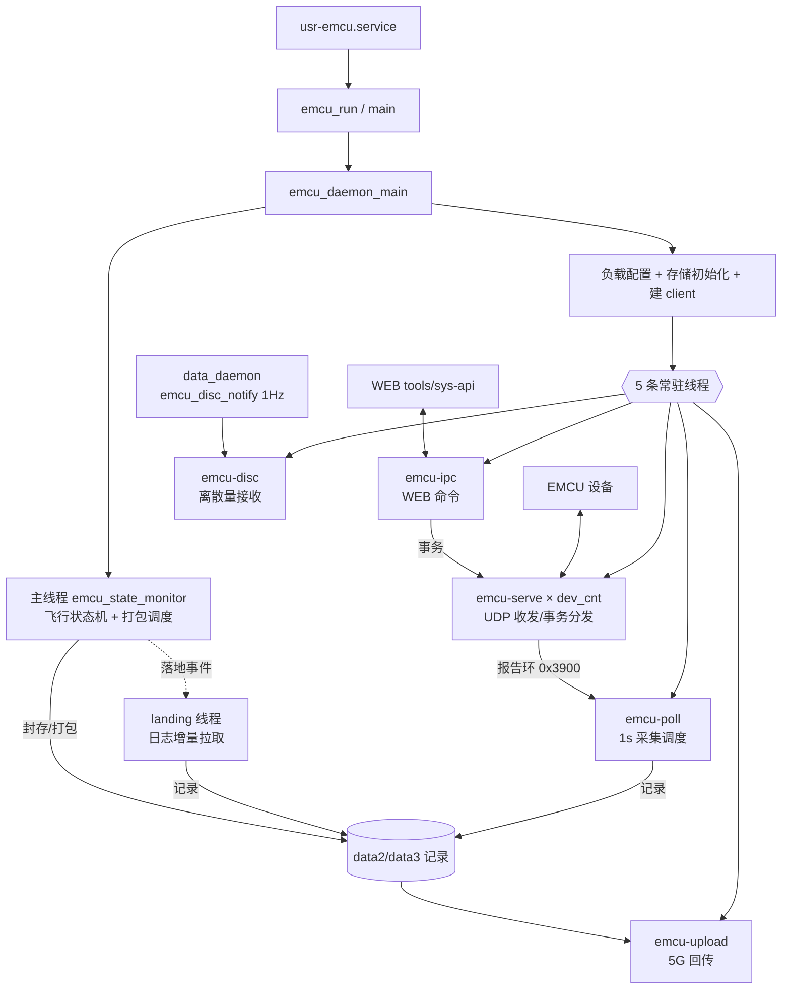
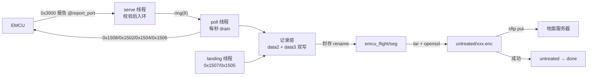
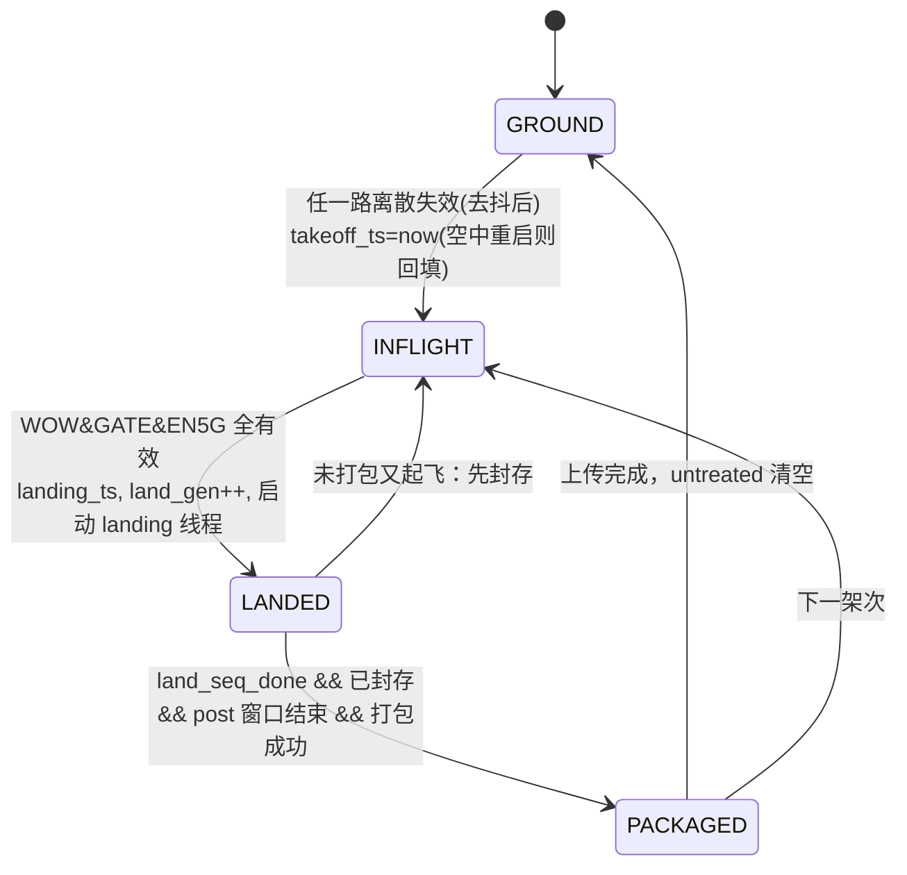
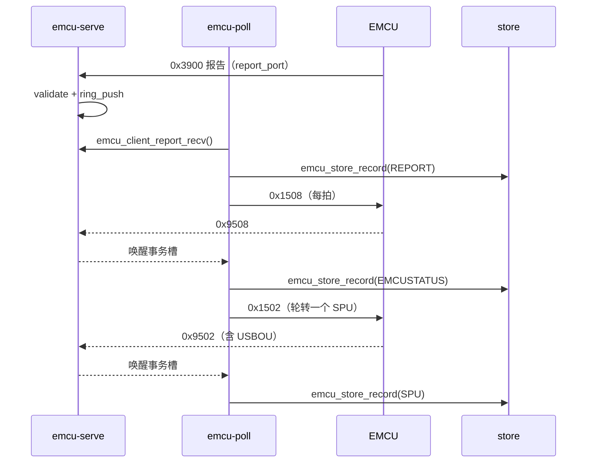
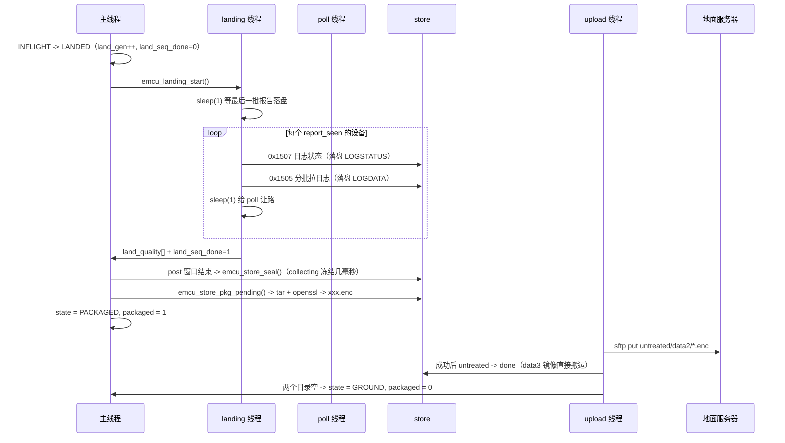
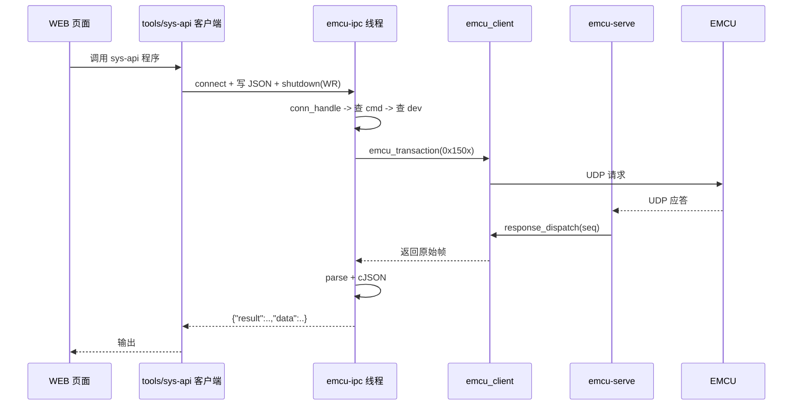

# EMCU 守护进程（emcu_run）框架与运行流程

> 适用代码：`lib/emcu_daemon/*`、`lib/emcu_icd/*`、`lib/emcu_notify/*`、`tools/emcu_run/`
> 进程：`emcu_run`（由 `usr-emcu.service` 拉起，Type=simple，restart always，前台运行）
> 本文按「总 → 分」组织：先讲主干与线程拓扑，再拆状态机，最后按线程逐条讲清各自的功能流程。

## 快速索引

| 想了解的内容 | 直接看 |
| --- | --- |
| 进程怎么起来、起了哪些线程 | [1.1](#11-进程入口)、[1.3](#13-线程拓扑) |
| 所有线程共享哪些变量 | [1.4 共享上下文 `g_emcu`](#14-共享上下文-g_emcu) |
| 起飞/落地怎么判定、状态怎么轮转 | [第 2 章](#第-2-章-主干状态机飞行窗口的开启与关闭) |
| 采集为什么"一秒一条"、发现流程多长 | [3.2](#32-emcu-poll1-hz-采集调度)、[3.3](#33-发现状态机地址遍历) |
| 落地日志、封存、打包、5G 上传 | [第 4 章](#第-4-章-落地链路日志封存打包与回传) |
| WEB 命令怎么下发到 EMCU / 离散量从哪来 | [第 5 章](#第-5-章-控制面对外接口ipc-与-disc) |

**线程总览（先记住这张表）**

| 线程名（`pthread_setname_np`） | 入口函数 | 数量 | 阻塞/节拍 | 一句话职责 |
| --- | --- | --- | --- | --- |
| `main`（主线程） | `emcu_state_monitor()` | 1 | `sleep(1)` | 飞行状态机 + 打包调度器，**进程活着的唯一理由** |
| `emcu-serve` | `emcu_client_serve()` | 每 EMCU 一个 | `poll(fds,2,100ms)` | UDP 收发与事务应答分发 |
| `emcu-poll` | `emcu_collect_poll_task()` | 1 | `sleep(1)` | 1 Hz 采集调度：报告、发现、状态轮询、对时 |
| `emcu-upload` | `emcu_upload_task()` | 1 | `sleep(1)` | 落地包 5G/SFTP 回传，完成后把状态推回 `GROUND` |
| `emcu-ipc` | `emcu_ipc_task()` | 1 | `accept()` | WEB sysapi（unix socket）命令服务 |
| `emcu-disc` | `emcu_disc_task()` | 1 | `recvfrom()` | 接收 data_daemon 推送的 WOW/GATE/EN5G |
| （临时） | `landing_sequence_thread()` | 每次落地 1 个 | 拉完即退出 | 落地日志增量拉取 |

> 注意：常驻线程是 **5 条**（serve/poll/upload/ipc/disc）；`landing` 线程是按事件（落地）创建的短生命周期线程，由主线程派生，完成即退出。

---

# 第 1 章 总体架构：主干与 5 条线程

**本章回答**：进程如何启动、各模块怎么分工、主干与线程之间靠什么通信、共享变量有哪些。

## 1.1 进程入口

`tools/emcu_run/emcu_run.c`：

```c
int main(int argc, char *argv[])
{
    (void)syslog_init();
    if (emcu_daemon_main(argc, argv) != OK) {
        printf("emcu_run start failed\n");
        return -1;
    }
    return 0;
}
```

`emcu_daemon_main()` 返回即进程退出，因此**主干必须阻塞**——实际就是 `emcu_state_monitor()` 的 `while(1)`。

## 1.2 主干启动时序（`emcu_daemon.c: emcu_daemon_main`）

```c
pthread_mutex_init(&g_emcu.disc_mutex, NULL);
load_daemon_config();          // 1) 读 local.conf 的 emcu_* 键
emcu_store_init();             // 2) 建 /mnt/data2、/mnt/data3 记录目录骨架
g_emcu.collecting = 1;         // 3) 打开记录写开关
create_udp_clients();          // 4) 每个 EMCU IP 建一个 client + 一对本地 UDP 端口
spawn_detached_thread(...);    // 5) serve × dev_cnt、poll、upload、ipc、disc
return emcu_state_monitor();   // 6) 主线程进入状态机（永不返回）
```

逐步说明：

1. **配置装载** `load_daemon_config()`
   - 先 `memset(&g_emcu.cfg, 0, ...)`，再逐项 `getDeviceConfig(key, ...)`，失败则用默认值并打 `WARN`。
   - `emcu_ip` 支持逗号分隔多机（当前机型 `EMCU_MAX_EMCU = 1`）。
2. **存储初始化** `emcu_store_init()`
   - 用 `access("/mnt/data2", W_OK)` 判定主盘/镜像盘就绪，置 `s_primary_disk_ready` / `s_mirror_disk_ready`（未挂载不致命，只是丢记录）。
   - `create_live_tree()`：在 data2/data3 上建立 `dev<N>/{report,spu,usbou,config,logstatus}` 及 7 个记录文件（`append_one_record` 只追加到已存在文件，缺文件会静默丢记录）。
   - 另建 `emcu_flight/`、`emcu_archive/untreated`、`emcu_archive/done`。
3. **打开采集开关** `g_emcu.collecting = 1`：`emcu_store_record()` 的唯一总闸，封存期间临时置 0。
4. **建立 UDP 客户端** `create_udp_clients()`
   ```c
   device->client = emcu_client_create(ip,
                        cfg.emcu_port,                  // 目的端口，EMCU 固定 9110
                        cfg.resp_port + device_index,   // 本地应答端口 9111+i
                        cfg.report_port + device_index);// 本地报告端口 9120+i
   ```
   每个 client 内部持有 `sock_resp`（发请求/收应答）与 `sock_report`（收 0x3900 报告）两个 socket，天然隔离两类流量。
5. **派生线程** `spawn_detached_thread()`：`pthread_create` + `pthread_setname_np` + `pthread_detach`，失败仅打日志不退出。
6. **主线程进状态机**。

## 1.3 线程拓扑



## 1.4 共享上下文 `g_emcu`

定义在 `include/internal/emcu_daemon.h`，**全进程唯一实例**（定义在 `emcu_state.c`）。

```c
typedef struct {
    emcu_config_t cfg;                 // 启动时一次性装载，运行期只读
    uint8_t  dev_cnt;
    emcu_dev_t dev[EMCU_MAX_EMCU];     // 每 EMCU 的运行上下文

    volatile int32_t state;            // emcu_flight_state_t
    time_t takeoff_ts;                 // 起飞墙钟（写 flight.info）
    time_t landing_ts;                 // 落地墙钟（拼 segment 名）
    time_t landing_mono_ts;            // 落地单调钟（post 窗口计时）
    volatile int32_t land_seq_done;    // 落地序列完成
    volatile int32_t land_gen;         // 落地代际（防串扰）
    volatile int32_t packaged;         // 本次航班 .enc 已就绪

    volatile int32_t collecting;       // 0 = 封存期间冻结写记录

    pthread_mutex_t disc_mutex;
    uint32_t disc_vals[EMCU_DISC_NUM]; // WOW/GATE/EN5G（0/1）
    volatile int32_t disc_recv;        // 是否收到过推送
} emcu_ctx_t;
```

`emcu_dev_t`（每个 EMCU 一份）：

| 字段 | 写者 | 读者 | 说明 |
| --- | --- | --- | --- |
| `client` | 主干 | 全部线程 | UDP 客户端句柄 |
| `ip` | 主干 | 日志 | 设备 IP |
| `report_seen` | poll | poll / landing / upload | 收到首个 0x3900，采集的**总开关** |
| `sync_done` | poll | poll | 0x1506 对时是否完成 |
| `discover_idx` | 主干（起飞时清 0）/ poll | poll | 配置发现游标：0=EMCU，1..max=SPU，>max=完成 |
| `spu_addrs[] / spu_cnt` | poll | poll / landing | 已发现的 SPU 编号（1..60） |
| `usbou_addrs[] / usbou_cnt` | poll | —（暂未使用） | 已发现的 USBOU 地址（`x<<8|y`） |
| `log_quality` | landing | 封存时写 flight.info | 0=跳过 1=完整 2=有失败 |

**同步原语清单**

| 原语 | 保护对象 | 备注 |
| --- | --- | --- |
| `g_emcu.disc_mutex` | `disc_vals` / `disc_recv` | 生产者 disc 线程，消费者状态机 |
| `s_store_mutex`（store.c） | 记录追加 vs 过滤重写/封存移动 | 防止 seal 期间漏写 |
| `s_log_index_mutex`（landing.c） | `emcu_log_idx.cfg` | poll 刷新与 landing 读写并发 |
| `cli->mutex + cli->cond`（client.c） | 事务槽表、报告环 | 条件变量绑定 `CLOCK_MONOTONIC` |
| `volatile` 标志位 | `state`/`packaged`/`land_seq_done`/... | **只保证可见性，不是原子操作**；靠"单写者 + 幂等判断"收敛 |

## 1.5 配置项（`local.conf`）

| 配置键 | 结构字段 | 默认值 | 用途 |
| --- | --- | --- | --- |
| `emcu_ip` | `cfg.emcu_ip` | `172.16.0.5` | 逗号分隔的 EMCU 列表 |
| `emcu_port` | `cfg.emcu_port` | 9110 | EMCU 侧目的端口 |
| `emcu_resp_port` | `cfg.resp_port` | 9111 | 本地应答端口基值（+i） |
| `emcu_report_port` | `cfg.report_port` | 9120 | 本地报告端口基值（+i） |
| `emcu_max_spu_addr` | `cfg.max_spu_addr` | 60 | 发现遍历上界（代码内再钳到 `EMCU_MAX_SPU`） |
| `emcu_pre_takeoff_s` | `cfg.pre_takeoff_s` | 300 | 地面滚动裁剪保留窗 / 空中重启回填 |
| `emcu_post_landing_s` | `cfg.post_landing_s` | 60 | 落地后封存等待窗 |
| `emcu_disk_used_max` | `cfg.disk_used_max` | 80 | 使用率水位，超过则拒绝封存 |
| `emcu_remote_ip` | `cfg.remote_ip` | 空 | 为空则上传功能关闭 |
| `emcu_remote_port` | `cfg.remote_port` | 22 | 地面 SFTP 端口 |
| `emcu_remote_user/password` | `cfg.remote_user/passwd` | `admin/admin` | 地面登录凭据 |
| `emcu_commu_port` | `cfg.commu_port` | 53001 | 校验消息通道（非 bench 路径） |
| `flight_tail` | `cfg.tail` | `EMCU` | 航段名 / 校验消息尾号 |

## 1.6 端到端数据流（一张图看懂）



---

# 第 2 章 主干状态机：飞行窗口的开启与关闭

**本章回答**：状态有哪几个、由什么驱动、每秒钟做了什么、涉及哪些变量、谁把状态推到下一格。

## 2.1 状态定义

`emcu_daemon.h`：

```c
typedef enum {
    EMCU_ST_GROUND = 0,   // 地面，滚动裁剪地面数据
    EMCU_ST_INFLIGHT,     // 空中，全量记录
    EMCU_ST_LANDED,       // 已落地，等日志拉取完成 + post 窗口
    EMCU_ST_PACKAGED      // 已打包，等 5G 上传
} emcu_flight_state_t;
```

## 2.2 输入：离散量推送与 11 拍去抖

GPIO 的 WOW/GATE/EN5G 三根线由 **start 进程（data_daemon）独占**，本进程拿不到（gpiolib 排他），所以走推送：

- 发送端：`emcu_notify.c: emcu_disc_notify()`，每秒一次，`"DISC %u %u %u\n"`。
- 接收端：`emcu_disc_task()` → `disc_vals_store()`，加锁写 `g_emcu.disc_vals[]` 并置 `disc_recv = 1`。

去抖（`emcu_state.c`）：

```c
static void debounce_discrete_input(uint32_t input_index,
                                    uint32_t *valid_samples,
                                    uint32_t *invalid_samples,
                                    uint32_t *debounced_status)
```

- 每拍读一次值；连续同值计数，**计数 > 10 才改状态**（即约 11 拍 ≈ 11 s）。
- 三路都仍是 `UNKNOWN` 时（首启/推送中断），状态机 `continue` 空转，**不迁移状态**。
- 判定落地：`is_aircraft_on_ground()` 要求三路同时 `DISCRETE_VALID`；任一失效即视为空中。

> 关键差异：地面判定要求"三路全有效且去抖后"，空中判定是"任一路失效"，因此空中判定更灵敏（起飞瞬间即可开窗），落地判定必须等三路稳定 11 s。

## 2.3 状态迁移表

| # | 迁移 | 触发条件 | 主线程动作 | 执行者 |
| --- | --- | --- | --- | --- |
| 1 | `GROUND → INFLIGHT` | 去抖后非全有效 | `takeoff_ts = now`（空中重启则 `boot_time - pre_takeoff_s`）；清 `land_seq_done/packaged/s_landing_sealed`；**每设备 `discover_idx=0`、`sync_done=0`**（新航段重新发现配置 + 重新对时） | 主线程 |
| 2 | `INFLIGHT → LANDED` | 三路全有效 | `landing_ts = time(NULL)`；`landing_mono_ts = CLOCK_MONOTONIC`；`land_gen++`；`land_seq_done = 0`；`emcu_landing_start()` 派生 landing 线程 | 主线程 |
| 3 | `LANDED → PACKAGED` | `land_seq_done && s_landing_sealed && !packaged`，且 `emcu_store_pkg_pending()` 返回 OK | `packaged = 1; state = PACKAGED` | 主线程（`run_package_scheduler`） |
| 4 | `LANDED → INFLIGHT` | 再次起飞（未打包完） | 若 `land_seq_done && !s_landing_sealed` 先 `seal_finished_flight()`；再走迁移 1（`booted_in_air=0` 分支） | 主线程 |
| 5 | `PACKAGED → INFLIGHT` | 下一架次起飞 | 直接 `enter_inflight_state(0, ...)` | 主线程 |
| 6 | `PACKAGED → GROUND` | 两个 `untreated` 目录都不含 `.enc` | `state = GROUND; packaged = 0` | **upload 线程** |
| 7 | `LANDED → GROUND`? | 不存在 | 打包必须经过 `PACKAGED`，即使打包失败也只是重试 | — |



## 2.4 主循环每拍执行顺序

`emcu_state_monitor()` 的 `while (1)`：

```c
1  debounce_discrete_input(WOW);
2  debounce_discrete_input(GATE);
3  debounce_discrete_input(EN5G);
4  if (三路有一路 UNKNOWN) { sleep(1); continue; }
5  if (on_ground) {
5a     booted_in_air = 0;                       // 已在地面观察到
5b     if (state == INFLIGHT)  -> 切 LANDED + 起 landing 线程
5c     if (state == GROUND)    -> 每 60 拍做一次 emcu_store_ground_trim()
   } else {
5d     if (state == GROUND)    -> enter_inflight_state(booted_in_air, boot)
5e     else if (LANDED)        -> 必要时先 seal，再 enter_inflight_state(0, boot)
5f     else if (PACKAGED)      -> enter_inflight_state(0, boot)
5g     booted_in_air = 0;                       // 只在首拍生效
   }
6  run_package_scheduler();                     // 封存 + 打包 + 转 PACKAGED
7  sleep(1);
```

## 2.5 涉及变量一览

**函数内局部（每次调用重建，跨拍靠 static 或全局保存）**

| 变量 | 作用 |
| --- | --- |
| `wow/gate/en5g_valid_count`、`*_invalid_count` | 去抖计数器（局部，常驻栈） |
| `wow/gate/en5g_status` | 去抖后状态（`UNKNOWN/VALID/INVALID`） |
| `ground_trim_ticks` | 地面裁剪节拍，满 60 触发一次 |
| `booted_in_air` | 启动后是否从未观测到地面（初值 1） |
| `boot_time_s` | 进程启动墙钟，用于空中重启回填起飞时间 |

**state.c 文件级 static**

| 变量 | 作用 |
| --- | --- |
| `s_package_failure_count` | 连续打包失败次数，决定退避 |
| `s_package_retry_monotonic_s` | 下次允许尝试的单调时刻 |
| `s_landing_sealed` | 本次落地是否已封存（每次起飞清 0） |
| `s_landing_segment_name` | 本次封存得到的航段名（仅日志用） |

**跨线程全局**：`state`、`packaged`、`land_seq_done`、`land_gen`、`takeoff_ts/landing_ts/landing_mono_ts`、`collecting`。

## 2.6 打包调度器 `run_package_scheduler()`

每拍最多做三件事，**全部以 `CLOCK_MONOTONIC` 计时**（避免 data_daemon 网络对时把墙钟阶跃带进窗口计算）：

1. **退避检查**：`now_mono < s_package_retry_monotonic_s` 直接返回。退避值 `15s << fail_count`，上限 300 s。
2. **封存（一次）**：条件 `state == LANDED && land_seq_done && !packaged && !s_landing_sealed`：
   - 还要满足 `now_mono - landing_mono_ts >= post_landing_s`；
   - 调 `seal_finished_flight()`：`collecting = 0` → `emcu_store_seal()` → `collecting = 1`（只有 rename 的几毫秒冻结写入，tar/openssl 在封存后的航段上做，不阻塞采集）；
   - 失败则 `fail_count++` 并推后重试，**原始记录不受影响**。
3. **打包+状态推进**：`emcu_store_pkg_pending()` 打包所有待处理航段；失败则退避返回；成功后清零计数，并在 `LANDED && land_seq_done && s_landing_sealed && !packaged` 时置 `packaged=1; state=PACKAGED`。

## 2.7 边界场景（代码里专门处理过的）

| 场景 | 处理方式 | 代码位置 |
| --- | --- | --- |
| **空中重启**（启动时飞机已在天上） | `booted_in_air` 保持 1，首次判空中时 `takeoff_ts = boot_time - pre_takeoff_s`，保证地面 5 分钟数据也算本航段 | `enter_inflight_state()` |
| **未打包又起飞** | 起飞分支里先 `seal_finished_flight()` 把上一段落地数据切出去，打包由调度器在空中继续做（post 窗口失效） | `emcu_state_monitor()` else 分支 |
| **landing 线程还没跑完就起飞** | 不封存（否则日志记录会被搬进下一航段），等 `land_seq_done` | 同上 |
| **上一次 landing 线程串到新一次落地** | `land_gen` 代际号：线程启动时快照 `gen`，结束时 `gen != g_emcu.land_gen` 就丢弃结果 | `landing_sequence_thread()` |
| **墙钟跳变** | post 窗口用 monotonic；发现/对时用 `check_wall_clock_jump()` 单独检测 | `emcu_state.c` / `emcu_collect.c` |
| **磁盘将满** | 使用率 ≥ `disk_used_max` 拒绝封存，记录继续写（降级但不丢） | `emcu_store_seal()` |
| **航段积压** | 待打包 ≥ `EMCU_SEG_PENDING_MAX (8)` 拒绝新封存 | `emcu_store_seal()` |

> 已知时序细节：若起飞发生在 landing 线程仍在跑的时候，`enter_inflight_state()` 不会递增 `land_gen`，该线程随后会把 `land_seq_done` 置 1（属于上一架次的完成信号）。由于空中不会触发封存、下次落地又会重置该标志，功能上无影响，但日志可能跨航段落入下一个 `log_data.dat`。

## 2.8 地面滚动裁剪

`state == GROUND` 时每 60 拍调用一次 `emcu_store_ground_trim()`：

- 只裁 `REPORT / SPU / USBOU / EMCUSTATUS` 四类（1 Hz 的 EMCU 状态不裁会无限增长）；
- 保留窗口 `[now - pre_takeoff_s - 300, now]`，双盘都裁；
- 用 `filter_record_file()`：读源 → 写 `.tmp` → `rename` 原子替换，写失败保留源文件。

---

# 第 3 章 数据面（一）：EMCU 通信与周期采集（serve + poll）

**本章回答**：UDP 报文怎么进出、事务怎么匹配、每秒到底采集了什么、发现流程多长。

## 3.1 `emcu-serve`：UDP 收发与事务分发

入口 `emcu_client_serve(cli)`，**每个 EMCU 一条**。

```c
fds[0] = sock_resp;    // 收应答（0x9xxx）
fds[1] = sock_report;  // 收 0x3900 报告
while (1) {
    poll(fds, 2, 100);                       // 100 ms 超时，顺带做 60s 统计
    if (resp 可读)   response_dispatch(...); // 按 seq + 期望码匹配事务槽，唤醒等待者
    if (report 可读) emcu_report_validate() ? report_push() : invalid_report++;
}
```

### 3.1.1 事务模型（请求/应答）

调用方（poll / landing / ipc）统一走：

```c
int32_t emcu_transaction_ex(emcu_client_t *cli, uint16_t req_code,
                            const uint8_t *payload, uint16_t payload_len,
                            uint32_t time_tag, uint8_t *resp_frame,
                            uint16_t *resp_len, int32_t *reason);
```

1. `seq = ++cli->seq`；
2. `slot_register(cli, seq, emcu_resp_code(req_code))` —— 在 8 个槽里登记"期望的应答码"（如 0x1502 → 0x9502）；
3. `emcu_frame_build()` 组帧（20 B 头 + 载荷 + `0x7E`）；
4. 最多 **3 次**发送（`ECMU_TIMEOUT_MS=1000` × `ECMU_MAX_RETRY=2`），每次 `slot_wait()`；
5. `slot_wait()` 用 `CLOCK_MONOTONIC` 条件变量等待，超时**保留槽位**以便下一次重传仍能匹配；
6. 失败原因写回 `reason`：`EMCU_TX_NO_SLOT/BUILD/SEND/TIMEOUT`，上层用 `emcu_tx_reason_str()` 打日志。

> 最坏一次事务 ≈ **3 s**（3 × T1），这是"发现流程很慢"的根因。

### 3.1.2 报告环

```c
#define EMCU_REPORT_RING 8
static void report_push(emcu_client_t *cli, const uint8_t *frame, uint16_t len);
int32_t emcu_client_report_recv(emcu_client_t *cli, uint8_t *buf, uint16_t *len);
```

- 环形队列 8 条，满时**覆盖最旧一条**（新状态优先，反正 poll 每秒清一次）；
- serve 线程只负责"收 + 入环"，不解析内容；解析和落盘在 poll 线程。

### 3.1.3 异常计数（60 s 限频告警）

`wrong_port_report`（0x3900 打到应答端口）、`unmatched_resp`、`dropped_report`、`invalid_report`，每分钟汇总打一条 `WARN`——用于定位"端口配错导致采集永远不启动"这类静默故障。

## 3.2 `emcu-poll`：1 Hz 采集调度

入口 `emcu_collect_poll_task()`：

```c
while (1) {
    check_wall_clock_jump();                 // 墙钟 vs 单调钟漂移 > 2s -> 全部 sync_done=0
    for (i = 0; i < g_emcu.dev_cnt; i++) {
        drain_device_reports(dev);           // 先把环形缓冲里的报告取空
        if (!dev->report_seen) continue;     // 设备还没上电
        run_device_discovery(dev);           // 每拍一次配置查询
        poll_device_once(dev, &rr);          // 0x1508 + 一个 SPU 的 0x1502
    }
    sleep(1);
}
```

### 3.2.1 报告落盘与"首个报告"语义

```c
while (emcu_client_report_recv(dev->client, buf, &len) == OK) {
    emcu_store_record(EMCU_REC_REPORT, idx, buf, len);
    s_last_report_time_s[idx] = time(NULL);
    if (!dev->report_seen) { dev->report_seen = 1; dev->discover_idx = 0; }
}
```

- `report_seen` 是**整个采集链路的使能位**：EMCU 未上电前不发任何请求；
- 报告间隔 > `REPORT_GAP_RESYNC_S (3 s)` → `sync_done = 0`，报告恢复后重新对时。

### 3.2.2 发现状态机（地址遍历）

`run_device_discovery()`，**每拍只发一条 0x1504**：

| `discover_idx` | 行为 |
| --- | --- |
| `0` | 查 `0x0000`（EMCU 本体 CI），然后 `idx = 1` |
| `1..max_spu_addr` | 查线地址 `idx << 8`（SPU x 的 CI + 其全部 USBOU CI），`idx++` |
| `> max_spu_addr` | 遍历结束；若 `!sync_done` 则 `sync_device_time()`（0x1506，TIME_TAG = 当日毫秒） |

- SPU 应答成功即证明设备在位：`add_spu_number(addr >> 8)`，并把应答里每个 USBOU 的 `equip_addr` 加入 `usbou_addrs[]`（去重）。
- 每发现一个地址都会调 `emcu_log_idx_refresh(addr, serial)` 刷新日志账本三元组（序列号变了 → 索引清 0）。
- 每次起飞 `discover_idx = 0`，**整轮重跑**，因此新航段里一定有本航段的 CONFIG 记录。
- 耗时估算：地址在位 ≈ 1 拍；不在位 → 事务超时 3 s。全量 60 个地址若大量缺失，最坏约 **3 分钟** 才能走完（这也是对时要等遍历结束的原因）。

### 3.2.3 连续轮询

```c
query_emcu_status(dev);                       // 0x1508，每拍一次
addr = dev->spu_addrs[(*rr)++ % dev->spu_cnt]; // 0x1502，每拍一个，轮转
query_spu_status(dev, addr);
```

- SPU 的 0x1502 响应里**已经带了该 SPU 下所有 USBOU 的状态**，所以 USBOU 从不单独轮询（0x1503 只留给 WEB 命令）；
- 每个成功应答都原样落盘：`REPORT / SPU / EMCUSTATUS / CONFIG`（`emcu_store_record()` 按 `dev` 分目录）；
- 轮转计数 `spu_round_robin` 是**所有设备共享**的一个变量，多 EMCU 时轮转会被交织（单机无影响）。

### 3.2.4 墙钟跳变检测

```c
clock_drift_s = now - (last_wall + (mono_now - last_mono));
if (|drift| > 2 s) 全部 dev->sync_done = 0;
```

用"墙钟增量 - 单调钟增量"判断真实的系统时间阶跃（data_daemon 的网络对时会 step 时间），避免把"某拍事务拖长"误判为跳变。

## 3.3 一次典型采集时序



## 3.4 本章涉及的关键宏

| 宏 | 值 | 含义 |
| --- | --- | --- |
| `ECMU_TIMEOUT_MS` / `ECMU_MAX_RETRY` | 1000 / 2 | 事务超时与重传 |
| `EMCU_PENDING_MAX` | 8 | 并发事务槽 |
| `EMCU_REPORT_RING` | 8 | 报告环深度 |
| `REPORT_GAP_RESYNC_S` | 3 | 报告中断判据 |
| `EMCU_TIME_JUMP_S` | 2 | 墙钟跳变阈值 |
| `ECMU_DISC_DEBOUNCE_NUM` | 10 | 离散量去抖门限（>10 拍生效） |

---

# 第 4 章 落地链路：日志、封存、打包与回传

**本章回答**：落地瞬间发生了什么、日志怎么做到"不重不漏"、文件怎么变成 `.enc`、怎么回到 `GROUND`。

## 4.1 触发与总览



## 4.2 landing 线程：日志增量拉取

入口：`landing_sequence_thread()`（`emcu_landing_start()` 里 `pthread_create` + `detach`）。

```c
int32_t gen = g_emcu.land_gen;     // 代际快照
sleep(1);
for (每设备) {
    quality[i] = 0;
    if (dev[i].report_seen) quality[i] = collect_device_logs(&dev[i]);  // 1=完整 2=有失败
}
if (gen != g_emcu.land_gen) return NULL;   // 已被新一次落地取代，丢弃结果
for (每设备) dev[i].log_quality = quality[i];
g_emcu.land_seq_done = 1;
```

`collect_device_logs()`：先 EMCU（地址 `0x0000`），再遍历 `spu_addrs[]`（线地址 `x << 8`）；每个设备之间 `sleep(1)` 把带宽让给 poll 线程。

### 4.2.1 拉取算法（不重不漏）

```c
query_log_status(addr, &log_status);      // 0x1507
log_data_pull(addr, log_status.current_log_number, log_status.prev_log_entry);
```

- `current_log_number`：当前日志索引；`prev_log_entry`：环形缓冲容量。
- 账本文件 `/mnt/software/emcu_log_idx.cfg`，每行 `"%04X <16位hex序列号> <已拉到的索引>"`。
- 区间计算：

| 账本情况 | 结果 |
| --- | --- |
| 无记录（首次落地） | 全环窗口 `[current-prev, current]` |
| `old_idx == current` | 无新日志，跳过 |
| `old_idx > current`（复位/换件） | 全环窗口 |
| `0 < current-old_idx <= prev` | 增量 `[old_idx+1, current]` |

- 分批 `0x1505`，每包最多 `ECMU_LOG_MAX_PER_REQ (30)` 条；条数由响应载荷长度除以 `ECMU_LOG_ENTRY_LEN (16)` 反推（不信任 LOG_LEN 字段）；连续失败 3 次放弃本轮。
- **只有整段拉完才推进账本索引**，失败则下次落地重拉同一区间。
- `emcu_log_idx_refresh()`（poll 线程在配置发现时调用）：同地址序列号变化 → 索引清 0（换件）；否则保持。

## 4.3 存储层：记录格式与双盘

`emcu_store.c`

```
记录 = [4B 时间戳(大端)][2B 帧长(大端)][原始 UDP 帧]
```

| 盘 | 角色 |
| --- | --- |
| `/mnt/data2` | 主盘，**上传源**，封存/打包都只认它 |
| `/mnt/data3` | 镜像盘，逐字节双写；打包时 `cp` 一份 `.enc` |

目录布局：

```
/mnt/data2/emcu_data/dev<N>/{report,spu,usbou,config,logstatus}/*.dat   ← 当前航段（活动文件）
/mnt/data2/emcu_flight/<tail>_<YYYYmmddHHMMSS>/...                      ← 已封存航段
/mnt/data2/emcu_archive/untreated/*.enc                                 ← 待上传包
/mnt/data2/emcu_archive/done/*.enc                                      ← 已上传包
```

7 类记录文件：`report/emcu_report.dat`、`report/emcu_status.dat`、`spu/spu_status.dat`、`usbou/usbou_status.dat`、`config/config_info.dat`、`logstatus/log_status.dat`、`logstatus/log_data.dat`。

> `usbou_status.dat` 目前没有写入者（USBOU 状态包含在 SPU 应答里），保留为空占位文件。

## 4.4 封存 `emcu_store_seal()`

前置检查（任一不满足就跳过，不影响继续记录）：

1. data2 就绪；
2. 活动树里有数据（`record_tree_has_data()`，否则"无记录可封存"直接返回 OK）；
3. 磁盘使用率 < `disk_used_max`；
4. 待打包航段数 < `EMCU_SEG_PENDING_MAX (8)`。

动作（持 `s_store_mutex`）：

```
1 生成航段名 <tail>_<landing_ts>，同秒重复则追加 _2.._9
2 create_segment_tree()（双盘建同样骨架）
3 move_live_tree_to_segment()：rename 活动文件 -> 航段目录
   （活动侧缺失的文件补空占位，保持归档结构一致）
4 写 flight.info（尾号、devCnt、起降时间、pre/post、每设备 logQuality）
5 create_live_tree()：重建空的活动树（否则下一航段全部丢记录）
```

`flight.info` 内容：

```c
tailNumber=...   devCnt=...
takeoffTime=<unix>   landingTime=<unix>
preTakeoffS=...   postLandingS=...
logQuality0=1      // 0=跳过 1=完整 2=有失败
```

## 4.5 打包 `emcu_store_pkg_pending()`

```c
package_one_segment(name):
    if (untreated/<name>.enc 已存在)  { remove_segment_tree(); return OK; }   // 崩溃后收尾
    if (航段内无数据)                 { remove_segment_tree(); return OK; }   // 空航段不打包
    compress_and_encrypt_segment():
        tar -zcf untreated/.emcu_stage.tar.gz -C <seg> .
        openssl aes-256-cbc -md md5 -salt -k Csw20#Qa -in ... -out .emcu_stage.part
        fsync(part) -> rename(part, <name>.enc) -> fsync(untreated 目录)
    cp <name>.enc /mnt/data3/emcu_archive/untreated/
    remove_segment_tree(name)        // 包落盘之后才删原始航段
```

设计要点：

- **先包后删、失败保留航段**：包失败只是延迟，永远不会丢航段；
- tar 与 openssl 分两步执行，能分别判断退出码（管道方式会把 tar 的失败掩盖成"空包"）；
- 临时文件名**不含 `enc`**，避免被 upload 线程误认为成品；
- 每轮 `emcu_store_pkg_pending()` 遇到第一个失败就 `break`，把调度器这一拍的时间压住，下拍按退避重试。

## 4.6 `emcu-upload`：5G 回传

入口 `emcu_upload_task()`：

```c
while (1) {
    if (g_emcu.packaged && g_emcu.state == EMCU_ST_PACKAGED) {
        if (cfg.remote_ip 为空) { WARN; sleep(1); continue; }   // 未配置 = 关闭上传
        if (wwan_valid() == OK) {                               // 4 步检查：接口存在/UP/有 IP
            if (emcu_upload_dir(UNTREATED0, DONE0) == OK)
                mirror_done_all();                              // 镜像直接搬 done，不重传
            else
                emcu_upload_dir(UNTREATED1, DONE1);             // 主盘失败才用镜像
            if (dir_enc_empty(UNTREATED0) && dir_enc_empty(UNTREATED1)) {
                state = EMCU_ST_GROUND;   // ← 唯一的"回地面"入口
                packaged = 0;
            }
        }
    }
    sleep(1);
}
```

### 4.6.1 单文件传输 `emcu_send_file()`

- 用 **OpenSSH sftp 客户端**，批处理命令从 **stdin** 喂入（`sftp -b` 会隐式加 `-oBatchMode=yes`，导致密码认证失效）；
- 守护进程无 tty，用 `SSH_ASKPASS` + `SSH_ASKPASS_REQUIRE=force` 脚本回显密码（`/tmp/emcu_sftp_passwd`，0600）；
- 连接参数：`ConnectTimeout=20`、`NumberOfPasswordPrompts=1`、`StrictHostKeyChecking=no`；
- 端口/用户/口令来自 `emcu_remote_*`；
- 结束即删三个临时文件。

### 4.6.2 校验消息（非 bench 路径）

```c
groundCommInit(cfg.remote_ip, cfg.commu_port);
emcu_send_file(path);
emcu_check_file(path);     // md5sum -> AES-128-CBC 加密 JSON -> 等 checkResult=true
groundCommClose();
rename(untreated/x.enc, done/x.enc);
```

JSON 字段：`msgType=1 / fileName / tailNumber / checkSum / dataType="emcu"`。

> ⚠️ **当前源码 `emcu_upload.c` 顶部 `#define EMCU_BENCH_TEST 1`**：走 `br0`、跳过 `groundCommInit/emcu_check_file`、sftp 成功即 rename 为 done，并有 `bench_force_package_gate()` 在无 EMCU 时强制把状态推到 `PACKAGED`。**量产构建前必须改回 0**，否则没有校验消息、且可能把没有真实航段的包标记完成。

## 4.7 一个航段从生到死（状态/目录对照）

| 阶段 | `g_emcu.state` | 关键目录动作 |
| --- | --- | --- |
| 地面待命 | `GROUND` | 活动树按 pre 窗口滚动裁剪 |
| 起飞 | `INFLIGHT` | 重新发现配置 + 对时，CONFIG 记录进本航段 |
| 落地 | `LANDED` | landing 线程拉日志；post 窗口计时 |
| 封存 | `LANDED` | 活动树 rename → `emcu_flight/<seg>/`，活动树重建 |
| 打包 | `LANDED` | `<seg>` → `untreated/<seg>.enc`，删除航段目录 |
| 待上传 | `PACKAGED` | `.enc` 留在 `untreated/` |
| 上传完成 | `GROUND` | `.enc` → `done/` |

---

# 第 5 章 控制面：对外接口（ipc 与 disc）

**本章回答**：WEB 页面怎么下发命令、离散量从哪来、以及运行期需要注意哪些约束。

## 5.1 `emcu-ipc`：WEB sysapi 服务

`emcu_ipc_task()`：

```c
unlink(EMCU_IPC_SOCKET_PATH);                    // /tmp/emcu_sysapi.sock
lfd = socket(AF_UNIX, SOCK_STREAM, 0);
bind(); chmod(0666); listen(lfd, 4);
while (1) {
    cfd = accept();
    pthread_create(&tid, NULL, conn_thread, cfd);   // 每连接一个 detached 线程
    pthread_detach(tid);
}
```

- **一连接一请求一应答**：`conn_read()` 读到 EOF 或缓冲满为止；客户端 `emcu_ipc_request()` 写完请求后 `shutdown(fd, SHUT_WR)`，服务端才能立刻返回应答。
- 服务端读超时 `IPC_CONN_TIMEOUT_S = 30 s`（防卡死客户端）；客户端读超时 10 s。
- 请求/应答缓冲：`4096 / 8192`。
- 请求可选字段 `"dev"`（默认 0）选择目标 EMCU：`conn_client()` 越界返回 NULL，命令直接失败。

### 5.1.1 命令表

| `cmd` | 请求字段 | ICD 报文 | 应答 `data` |
| --- | --- | --- | --- |
| `setPower` | `control` | 0x1300 | `powerStatus` |
| `setSpu` | `spuAddr`,`powerCtrl`,`usbouCtrl` | 0x1501 | `powerStatus` |
| `getSpuStatus` | `spuAddr` | 0x1502 | `spuAddr/totPwr/temp/status/usbous[]` |
| `getUsbouStatus` | `usbouAddr` | 0x1503 | `spuAddr/usbous[]`（含 pwrA/pwrC） |
| `getConfigInfo` | `equipAddr` | 0x1504 | `units[]`（地址/硬件/序列号/软件） |
| `getLog` | `equipAddr`,`logAddr`,`logLen` | 0x1505 | `equipAddr/logLen/dataHex`（最多 500 B） |
| `syncTime` | — | 0x1506 | `execStatus` |
| `getLogStatus` | `equipAddr` | 0x1507 | `currentLogNumber/prevLogEntry` |
| `getEmcuStatus` | — | 0x1508 | `spuCnt/temp/totPwr/chPwr[5]/workMode` |
| `upgrade` | `updateType`,`fwLen`,`fwCrc` | 0x150A | `fwUpgSta` |
| `upgradeData` | `fragOffset`,`dataHex` | 0x150B | `fragRecvSta/rcvCmpOffAddr` |

统一应答格式：

```json
{"result":0,"error":"","data":{ ... }}
```

`result` 为 `OK(0)` 表示成功，非 0 时 `data` 省略。

### 5.1.2 升级命令细节（`emcu_ipc_upgrade.c`）

- `dataHex` 十六进制字符串 → 二进制（奇数长度/非法字符直接失败）；
- 单帧上限 `ECMU_UPGRADE_FRAG_MAX = 1472 - 20 - 1 - 9 = 1442` 字节，保证整包不超 ICD 的 1472 B 限制。

### 5.1.3 WEB 命令的端到端路径



> 注意：IPC 命令与 poll/landing **共用同一批 client 实例**，共享 8 个事务槽；高峰期可能出现 `EMCU_TX_NO_SLOT`，日志里会以 `no free transaction slot` 出现。

## 5.2 `emcu-disc`：离散量接收

`emcu_disc_task()`：

```c
unlink("/tmp/emcu_disc.sock");
fd = socket(AF_UNIX, SOCK_DGRAM, 0);
bind(); chmod(0666);
while (1) {
    n = recvfrom(fd, buf, ...);
    if (sscanf(buf, "DISC %u %u %u", &wow, &gate, &en5g) != 3) continue;
    disc_vals_store(wow, gate, en5g);      // 归一化为 0/1，加锁写 + disc_recv=1
}
```

- 发送端 `emcu_disc_notify()`（链接进 start 进程）1 Hz 调用，socket 首次使用时创建，发送失败即关闭重建（容忍 daemon 重启）；
- 本线程只做"存值"，**不做去抖**——去抖在状态机里（见 2.2），这样状态机可以独立决定采样节拍。

## 5.3 运行期注意事项与已知约束

| 关注点 | 说明 |
| --- | --- |
| **`EMCU_BENCH_TEST=1`** | `emcu_upload.c` 当前为台架模式（br0、跳过校验、强制 PACKAGED），量产必须置 0 |
| 发现遍历耗时 | 每秒一个地址，缺位地址每次 3 s 超时；60 个地址最坏约 3 分钟，期间不会对时 |
| `state` 跨线程写 | 主线程与 upload 线程都会写，`volatile` 无原子性；靠"单侧条件 + 幂等赋值"收敛，非严格同步 |
| `spu_addrs/spu_cnt` | poll 线程写（每次起飞重跑发现），landing 线程读，**无锁**；起飞瞬间仍在拉日志时存在读写竞争 |
| `EMCU_REC_USBOU` | 记录文件创建但不写入（USBOU 随 0x1502 返回） |
| `dir_enc_empty()` | 目录不存在按"空"处理，data3 未挂载时可能提前判定"上传完成"回到 GROUND |
| 日志账本 | `/mnt/software/emcu_log_idx.cfg` 位于软件分区，掉电可能导致"重拉一整环"而非丢日志（幂等由 EMCU 侧索引决定） |
| 航段积压 | 超过 8 个待打包航段会拒绝新封存，记录继续写入活动树（合并到下一航段） |
| IPC 客户端协议 | 必须 `shutdown(SHUT_WR)`，否则服务端要等 30 s 读超时才处理请求 |

## 5.4 排障关键词（syslog）

| 日志片段 | 含义 |
| --- | --- |
| `first EMCU report received, start discovery` | 设备上电，开始发现 |
| `EMCU status query failed: no response (timeout)` | 设备不回包 / IP 端口错 |
| `wrongPortReports=... droppedReports=...` | 端口配置错误或报告溢出 |
| `wall clock jumped ... force EMCU re-sync` | 系统对时发生阶跃 |
| `flight records sealed: <seg>` | 封存成功 |
| `package ok: ...enc` | 打包成功 |
| `segment backlog full` | 积压到上限，封存被拒 |
| `flight data uploaded, back to GROUND` | 上传完成闭环 |
| `landing sequence gen=... superseded` | 旧落地线程被新落地取代（正常保护） |

---

## 附：模块—职责速查

| 文件 | 核心函数 | 职责 |
| --- | --- | --- |
| `emcu_daemon.c` | `emcu_daemon_main` | 配置装载、client 创建、线程派生、交给状态机 |
| `emcu_state.c` | `emcu_state_monitor` / `run_package_scheduler` | 飞行状态机 + 封存打包调度 |
| `emcu_collect.c` | `emcu_collect_poll_task` | 1 Hz 采集、发现、对时、跳变检测 |
| `emcu_landing.c` | `landing_sequence_thread` / `log_data_pull` | 落地日志增量拉取与账本 |
| `emcu_store.c` | `emcu_store_*` | 记录双写、滚动裁剪、封存、打包 |
| `emcu_upload.c` | `emcu_upload_task` | 5G/SFTP 回传与状态回归 |
| `emcu_ipc.c` | `emcu_ipc_task` / `conn_handle` | WEB unix socket 命令服务 |
| `emcu_ipc_upgrade.c` | `emcu_ipc_cmd_upgrade*` | 升级命令（0x150A/0x150B） |
| `emcu_disc.c` | `emcu_disc_task` | 离散量推送接收 |
| `emcu_notify.c` | `emcu_disc_notify` | 推送发送端（start 进程侧） |
| `emcu_icd/emcu_client.c` | `emcu_client_*` | UDP 双 socket、事务槽、报告环 |
| `emcu_icd/emcu_frame.c` / `emcu_codec.c` | `emcu_req_*` / `emcu_parse_*` | 组帧与解析 |
| `emcu_icd/emcu_ipc_client.c` | `emcu_ipc_request` | sys-api 工具侧客户端 |
| `tools/emcu_run/emcu_run.c` | `main` | 进程入口 |
