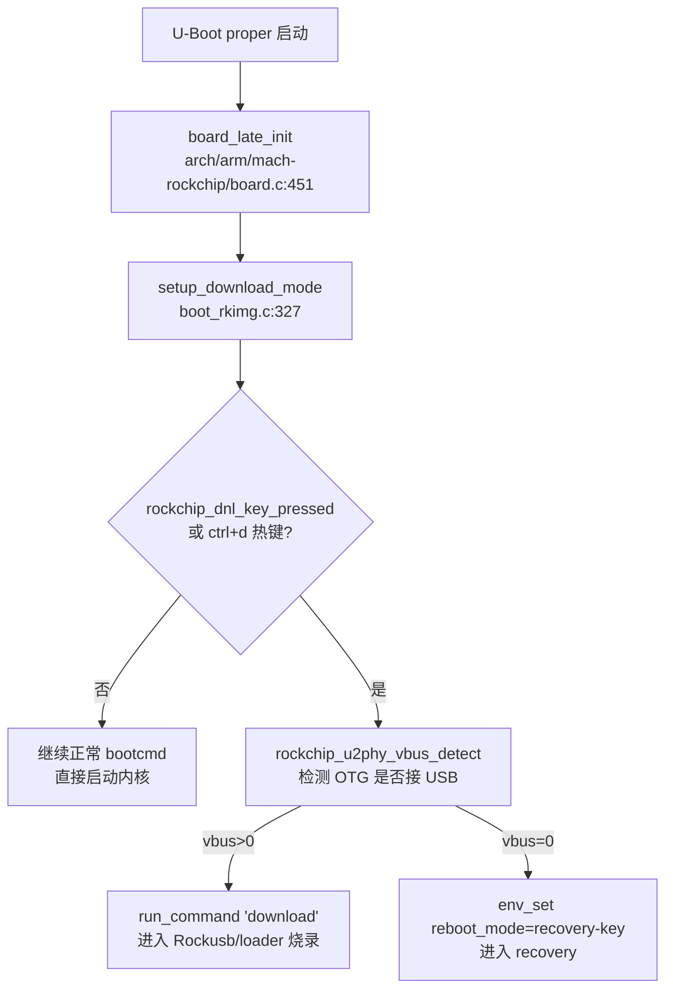

- [1. 分区表修改](#1-分区表修改)
- [2. 日志模块](#2-日志模块)
  - [2.1. Linux 中的日志系统](#21-linux-中的日志系统)
    - [2.1.1. journal](#211-journal)
    - [2.1.2. rsyslog](#212-rsyslog)
  - [2.2. 挂载日志分区](#22-挂载日志分区)
  - [2.3. 在已有的 rootfs 源码上添加包](#23-在已有的-rootfs-源码上添加包)
  - [2.4. 717 涉及到的日志模块（已弃用）](#24-717-涉及到的日志模块已弃用)
  - [2.5. rk3568迁移问题](#25-rk3568迁移问题)
    - [2.5.1. 禁用 busybox-syslog](#251-禁用-busybox-syslog)
    - [2.5.2. 安装 rsyslog](#252-安装-rsyslog)
    - [2.5.3. 修复 rsyslog 依赖](#253-修复-rsyslog-依赖)
- [3. 内核调试网口](#3-内核调试网口)
  - [3.1. 源码追寻](#31-源码追寻)
- [4. eeprom](#4-eeprom)
  - [4.1. nvmem 子系统](#41-nvmem-子系统)
    - [4.1.1. 为啥还可以用老接口](#411-为啥还可以用老接口)
  - [4.2. 24LC32A 芯片手册](#42-24lc32a-芯片手册)
    - [4.2.1. 写操作](#421-写操作)
    - [4.2.2. 读操作](#422-读操作)
    - [4.2.3. 驱动实现](#423-驱动实现)
- [5. BITE](#5-bite)
  - [5.1. 基本检测项](#51-基本检测项)
    - [5.1.1. 关于阈值检测](#511-关于阈值检测)
  - [5.2. IBIT 相关](#52-ibit-相关)
    - [5.2.1. Json 格式转化](#521-json-格式转化)
  - [5.3. 与老 WAP(WAP1002) 对标](#53-与老-wapwap1002-对标)
- [6. systemd 服务机制与原理](#6-systemd-服务机制与原理)
  - [6.1. systemd 目录](#61-systemd-目录)
  - [6.2. Unit 和 Target](#62-unit-和-target)
  - [6.3. Unit 文件格式](#63-unit-文件格式)
    - [6.3.1. Unit 段](#631-unit-段)
    - [6.3.2. Install 段](#632-install-段)
    - [6.3.3. Service 段](#633-service-段)
  - [6.4. 服务怎么被调用](#64-服务怎么被调用)
  - [6.5. 如何写一个完整的服务](#65-如何写一个完整的服务)
- [7. history 无法保存](#7-history-无法保存)
  - [7.1. /etc/profile](#71-etcprofile)
  - [7.2. 交互？登录？](#72-交互登录)
- [8. ATP-OFP 修改](#8-atp-ofp-修改)
- [9. 在线更新分区表](#9-在线更新分区表)
  - [9.1. U-boot 下的 `gpt` 命令](#91-u-boot-下的-gpt-命令)
    - [9.1.1. uuid 的获取](#911-uuid-的获取)
  - [9.2. 重构 `partitions`](#92-重构-partitions)
  - [9.3. U-boot 下检查gpt分区](#93-u-boot-下检查gpt分区)
- [10. 板子调试串口问题](#10-板子调试串口问题)
  - [10.1. 现象](#101-现象)
  - [10.2. 排查](#102-排查)
- [11. 内核配置U-boot环境变量](#11-内核配置u-boot环境变量)
  - [11.1. libubootenv 工具简介](#111-libubootenv-工具简介)
  - [11.2. 使用方法](#112-使用方法)
  - [11.3. mmc 配置详解](#113-mmc-配置详解)
- [12. U-boot 下网口问题](#12-u-boot-下网口问题)
  - [12.1. PC 端防火墙导致的 ping 不通](#121-pc-端防火墙导致的-ping-不通)
  - [12.2. U-boot 硬复位网络不通](#122-u-boot-硬复位网络不通)
  - [12.3. 回到原点](#123-回到原点)
  - [12.4. 小结](#124-小结)
- [13. U-boot 无法识别 Loader 模式](#13-u-boot-无法识别-loader-模式)
  - [13.1. 完整调用链路](#131-完整调用链路)
  - [13.2. 根因](#132-根因)
  - [13.3. 三、修复方向](#133-三修复方向)
- [14. Applications 编译梳理](#14-applications-编译梳理)
  - [14.1. Applications 源码](#141-applications-源码)
- [15. OpenSSH 移植问题](#15-openssh-移植问题)
  - [15.1. 配置步骤](#151-配置步骤)
    - [15.1.1. 禁用 dropbear](#1511-禁用-dropbear)
    - [15.1.2. 启用 sshd.socket](#1512-启用-sshdsocket)
    - [15.1.3. 预生成主机密钥（只读根文件系统的关键）](#1513-预生成主机密钥只读根文件系统的关键)
    - [15.1.4. 登录认证配置（drop-in）](#1514-登录认证配置drop-in)
    - [15.1.5. 修正 systemd preset（防止将来重新启用 dropbear）](#1515-修正-systemd-preset防止将来重新启用-dropbear)
    - [15.1.6. 添加 sshd 特权分离用户（必需）](#1516-添加-sshd-特权分离用户必需)
  - [15.2. 板端验证](#152-板端验证)
  - [15.3. 常见问题排查](#153-常见问题排查)
  - [15.4. 注意事项与安全说明](#154-注意事项与安全说明)
- [16. Web-Docker 编译环境移植](#16-web-docker-编译环境移植)

# 1. 分区表修改

u-boot 网口的调试，主要的用法就是使用 tftp 协议从 server 端下载固件进行升级，这样就可以不用依赖 usb 串口+厂商工具进行烧录，直接往存储设备中写入固件就行。

分区表在其中有着很关键的作用，通过 `fdisk -l` 等命令可以查看当前分区情况，我们将固件通过分区的形式实现隔离，这样能够避免数据间的污染。rockchip 官方提供的 yocto 工程使用 wks.in 脚本来制作 `wic` 镜像，并且内置分区表，导出后为 `parameter` 文件。我们可以手动编写该文件，并且单独加载各个 `raw` 固件镜像。只需要在首次烧录时使用 rockchip 的专用烧录工具。后续只需要通过网口向对应的分区中写入固件镜像即可完成升级调试(`mmcblkXpX` 在`dev`目录下可以被当作块设备被操作)。

而 `parameter` 本身是由 `wks.in` 脚本在构建镜像时自动导出的，手动编辑在分区复杂时将会非常繁琐，所以搞了一个编写分区表的脚本 `generate_parameter.sh`：

```bash
#!/usr/bin/env bash
set -euo pipefail

IMAGE_NAME="cetca-wap2001-minimal-rk3568-wap2001.rootfs.wic"
FIRMWARE_VER="1.0"
TYPE="GPT"
OFFSET="8M"
DEFAULT_ALIGN="4M"
ROOTFS_UUID="614e0000-0000-4b53-8000-1d28000054a9"
OUTPUT="${1:-parameter.txt}"

PARTITIONS=(
"uboot       4M     normal"
"uboot-env   4M     normal"
"board-info  4M     normal"
"reserve0    4M     normal"
"dtb         8M     normal"
"boot      256M     bootable"
"rootfs    512M     normal"
"log          2G    normal"
"app          2G    normal"
"reserve1     2G    normal"
"reserve2     2G    normal"
"reserve3     2G    normal"
"reserve4     2G    normal"
"reserve5     2G    normal"
"blank        -     grow"
)

size_to_blocks(){
 local s=$1
 [[ $s == "-" ]] && { echo "-"; return; }
 local n=${s::-1}; local u=${s: -1}
 case "$u" in
  K|k) echo $((n*1024/512));;
  M|m) echo $((n*1024*1024/512));;
  G|g) echo $((n*1024*1024*1024/512));;
  *) echo "Bad size $s" >&2; exit 1;;
 esac
}
align_up(){ local v=$1 a=$2; echo $(( ((v+a-1)/a)*a )); }

START=$(size_to_blocks "$OFFSET")
DEFALIGN=$(size_to_blocks "$DEFAULT_ALIGN")
CMD="mtdparts=rk29xxnand:"
PADTOTAL=0
FIXED=0

{
echo "# IMAGE_NAME: $IMAGE_NAME"
echo "FIRMWARE_VER: $FIRMWARE_VER"
echo "TYPE: $TYPE"
echo "/**************************************************************"
printf "%-12s %-12s %-12s %-8s %-8s\n" "Start" "End" "Name" "Size" "Pad"
for p in "${PARTITIONS[@]}"; do
 read -r NAME SIZE ATTR ALIGN <<<"$p"
 [[ -z ${ALIGN:-} ]] && ALIGN=$DEFAULT_ALIGN
 if [[ $ATTR == grow ]]; then
   printf "0x%08X %-12s %-12s %-8s %-8s\n" "$START" "*" "$NAME" "Grow" "-"
   CMD+=",-@$(printf '0x%08X' $START)(${NAME}:grow)"
   break
 fi
 AB=$(size_to_blocks "$ALIGN")
 NS=$(align_up "$START" "$AB")
 PAD=$((NS-START))
 PADTOTAL=$((PADTOTAL+PAD))
 START=$NS
 BLK=$(size_to_blocks "$SIZE")
 END=$((START+BLK-1))
 FIXED=$((FIXED+BLK))
 MB=$((BLK*512/1024/1024))
 if ((MB>=1024)); then SS="$((MB/1024))G"; else SS="${MB}M"; fi
 PMB=$((PAD*512/1024/1024))
 printf "0x%08X 0x%08X %-12s %-8s %-8s\n" "$START" "$END" "$NAME" "$SS" "${PMB}M"
 if [[ $ATTR == bootable ]]; then
   CMD+=$(printf "0x%08X@0x%08X(%s:bootable)," "$BLK" "$START" "$NAME")
 else
   CMD+=$(printf "0x%08X@0x%08X(%s)," "$BLK" "$START" "$NAME")
 fi
 START=$((END+1))
done
echo "**************************************************************/"
echo
echo "CMDLINE: $CMD"
echo "uuid: rootfs=$ROOTFS_UUID"
echo
echo "# Summary"
echo "# Offset: $OFFSET"
echo "# Default Align: $DEFAULT_ALIGN"
echo "# Alignment Padding: $((PADTOTAL*512/1024/1024)) MB"
echo "# Fixed Size: $((FIXED*512/1024/1024/1024)) GB + $((((FIXED*512/1024/1024)%1024))) MB"
} > "$OUTPUT"

echo "Generated $OUTPUT"
```

-----------------

# 2. 日志模块

有关目前我们所使用的日志模块的一个通用设计，我单独放了一个示例在这里：

[日志模块机制分析](16-wap2001日志模块工作机制分析.md)

以及对应的实例，这里我将 applications 中的对应源码和 rootfs 下的配置文件单独摘出来放在这里 -> `17-wap2001日志模块示例`。

大概明白了整个日志模块的设计，还需要补一补 Linux 内核中对日志系统的设计。

## 2.1. Linux 中的日志系统

目前 WAP 使用的日志系统主要是结合 systemd.journald 和 rsyslog，然后辅助 logrotate 和 cron 进行日志的轮转。

在 Linux 中，rsyslog 和 journal 都是系统日志管理机制，作用都是收集、保存和查询系统运行过程中产生的日志。不过它们属于不同年代、不同设计理念的日志系统。

简单理解：

- journal（systemd-journald）：systemd 体系里的日志服务，负责收集系统日志。
- rsyslog：传统 Syslog 体系里的日志服务，负责进一步处理、分类、转发和保存日志。

两者经常同时存在，关系类似：

```
各种程序
   |
   |  syslog API / stdout / kernel message
   |
   v
+----------------+
| systemd-journald|
|   (journal)    |
+----------------+
        |
        | 转发
        v
+----------------+
|    rsyslog     |
+----------------+
        |
        |
        v
/var/log/messages
/var/log/syslog
/var/log/auth.log
...
```

### 2.1.1. journal

这里的 journal 实际上是 systemd 管理的一个服务组件。systemd 下管理了很多服务，所有服务的 `stdout/stderr` 默认都会被 journald 收集。包括我们用户态程序的 `printf` 或者 `syslog` 也会被 journal 收集。

systemd-journald 维护两套日志存储：

\- **持久存储**（`/var/log/journal/`）：掉电不丢失

\- **运行时存储**（`/run/log/journal/`）：仅存于内存，重启即清空

需要注意的是，`journal/`目录下保存的不是文本文件，无法直接使用 `cat` 阅读，而是二进制数据库。想要读取 journal 日志，需要使用对应的命令 `journalctl`。

journal 可以通过 `/etc/systemd/journald.conf` 配置文件来控制行为。

### 2.1.2. rsyslog

rsyslog 是传统 syslog 的增强版。早期 linux 没有 systemd 时走的是：

```
应用程序 - syslog -syslogd - 文本文件
```

后来发展成了 rsyslog，它会负责：
- 分类日志
- 写文件
- 远程转发
- 日志过滤
- 日志轮转

想要配置的话可以通过

```
/etc/rsyslog.conf
/etc/rsyslog.d/*.conf
```

## 2.2. 挂载日志分区

目前根文件系统的自动服务脚本有两套：

- /etc/user.init 和 /etc/user.local
- /usr/bin/custom_startup.sh

其中 custom_startup.sh 是通过 deb 包安装的方式导入的一个 systemd 服务。我们手动编写的话可以直接放在 /etc 下。

目前还需要解决日志分区挂载的问题。

直接修改 fstab 只能够将具有文件系统的分区在初始化阶段进行挂载，没有办法直接挂载不具备文件系统的空分区。所以我们还是选择自己写 systemd 服务来完成这项工作。一般 systemd 服务的 *.service 文件可以直接放在 /etc/systemd/system 下，也可以放在 /lib/systemd/system 下，区别是：

```
/etc/systemd/system/
    ↑ 最高优先级（管理员自定义）

/run/systemd/system/
    ↑ 运行时生成的 unit

/lib/systemd/system/
    ↑ 软件包安装提供的默认 unit
```

我们自己写的还是推荐直接放在 /etc 目录下。

1. /etc/systemd/system 下放置 *.service
2. /etc 下放置服务脚本，记得修改执行权限

另外需要注意的是， *.service 中会有服务或者目标依赖：

```
[Install]
WantedBy=sysinit.target
```

那么需要在对应的 sysinit.target.wants 目录下创建 service 文件的软链接，这样制作出的根文件系统镜像才会把该服务在初始化阶段拉起来。

## 2.3. 在已有的 rootfs 源码上添加包

由于 rootfs 源码不是我编译得到的，想要额外通过 yocto 来添加工具就不能直接改 yocto 的源码了，那么我们就可以直接使用 yocto 编译对应的工具包，然后将它的 image 目录下的文件拷贝到现在的 rootfs 源码中就好。

## 2.4. 717 涉及到的日志模块（已弃用）

在底层软件 `applications` 中，有一个 `data_daemon` 的 `lib` 工具模块，它应该是 717 的一个守护进程。实际上这个应该是老wap中使用的，这里已经被弃用了。

## 2.5. rk3568迁移问题

由于 rk3568 的系统镜像在制作之初，根文件系统采用的是 busybox 自带的 busybox-syslog，并且并未安装 rsyslog，所以看到的结果就是在 `/var/log/rsyslog` 下**看不到系统日志**。经过排查发现 `systemctl status rsyslog` 根本没有服务。启用的反而是 `syslog`。

因此需要对根文件系统进行修改，主要包括：

- 禁用 busybox-syslog；
- 安装 rsyslog 及其 依赖；
- 启用 rsyslog；

由于它们都是作为 systemd 服务，因此我们可以通过修改根文件系统中的对应配置文件来完成服务的启用和禁用。这个和前面挂载日志分区类似，并且我们无需手写 `.service` 文件。

### 2.5.1. 禁用 busybox-syslog

在板子系统中用 `systemctl list-unit-files | grep -i sys` 来查看启用的日志模块。发现使用的其实是 `busybox-syslog` 并且有一个别名叫 `syslog.service`。

在源码目录下检索 `busybox-syslog` 可以在多个地方看到相关的文件，其中比较重要的就是 `busybox-syslog.service` 这个，**一般它会创建一个软链接到 `*.wants` 目录下，这样系统就会直接启用该服务，这里是被拷贝到了 `etc/systemd/system/multi-user.target.wants/` 下**，并且还创建了 `etc/systemd/system/syslog.service` 这个软链接，也就是其别名。

还发现在 `lib/systemd/system-preset/98-busybox-syslog.preset` 中有 `enable` 该服务。

因此主要就是删除对应的软链接，然后 `disable` 保证系统启动时不会再次软链接。

这里就把启用 rsyslog 一起说了，就是复刻 busybox-syslog 的做法，创建两个软链接(wants 目录和别名)，至于 `preset`，我们手动完成了软链接的创建，应该可以省略。

### 2.5.2. 安装 rsyslog

将 `bitbake rsyslog` 得到的 `tmp/work/<architecture>/rsyslog/<vision>/image/` 下的相关可执行文件和依赖拷贝到根文件系统源码中。注意不要覆盖我们之前写好的 `etc/rsyslog.conf`，这是我们日志系统的核心配置文件。

### 2.5.3. 修复 rsyslog 依赖

按理说我们安装了 rsyslog 并且启用该服务，禁用 busybox-syslog 就应该能够正常起日志模块了，但是事实是我们的日志模块挂了。

具体信息可以参考调试信息，我们利用 `which rsyslog` 以及 `/usr/sbin/rsyslog -v` 来查看模块的情况，结果发现缺少依赖。

其实还可以用 `ldd` 命令来查看，不过需要单独安装包。

我们就可以一样通过 `bitbake *` 命令编译缺少的包，然后拷贝到跟文件目录中，最后服务启动，`/var/log/rsyslog/` 下正常输出日志。问题得到解决~

-------------------

# 3. 内核调试网口

设备的 GMAC1 外界一个 MARVELL 88E1512 千兆PHY。并且采用独立的外部晶振作为时钟输入。目前的设备树配置为：

```c
&gmac1 {
 phy-mode = "rgmii-id";
 clock_in_out = "input";

 snps,reset-gpio = <&gpio3 RK_PD4 GPIO_ACTIVE_LOW>;
 snps,reset-active-low;
 snps,reset-delays-us = <0 20000 100000>;

    assigned-clocks = <&cru SCLK_GMAC1_RX_TX>, <&cru SCLK_GMAC1>;
    assigned-clock-parents = <&cru SCLK_GMAC1_RGMII_SPEED>, <&cru CLK_MAC1_2TOP>;
 assigned-clock-rates = <0>, <125000000>;

 pinctrl-names = "default";
 pinctrl-0 = <&gmac1m1_miim
       &gmac1m1_tx_bus2
       &gmac1m1_rx_bus2
       &gmac1m1_rgmii_clk
       &gmac1m1_rgmii_bus>;

 /*phy-supply = <&vcc3v3>;*/
 phy-handle = <&wap_rgmii_phy1>;
 status = "okay";

 
};

&mdio1 {
 wap_rgmii_phy1: phy@1 {
  compatible = "ethernet-phy-ieee802.3-c22";
  reg = <0x1>;
 };
};
```

dmesg 输出：

```
[   19.041829] rk_gmac-dwmac fe010000.ethernet end1: Register MEM_TYPE_PAGE_POOL RxQ-0
[   19.042591] rk_gmac-dwmac fe010000.ethernet end1: in stmmac_init_phy(): fwnode's compatible of_node is: ethernet
[   19.042726] rk_gmac-dwmac fe010000.ethernet end1: in stmmac_init_phy(): phy_fwnode's compatible of_node is: phy
[   19.042746] rk_gmac-dwmac fe010000.ethernet end1: gmac driver run this way: phylink_fwnode_phy _connect()
[   19.042771] Generic Clause 45 PHY stmmac-1:01: mdio driver is Generic Clause 45 PHY
[   19.043931] rk_gmac-dwmac fe010000.ethernet end1: phy_attach_direct() return: 0
[   19.044002] rk_gmac-dwmac fe010000.ethernet end1: validation of  with support 00000000,00000000,00006000 and advertisement 00000000,00000000,00000000 failed: -EINVAL
[   19.044029] rk_gmac-dwmac fe010000.ethernet end1: phylink_bringup_phy() return: -22
[   19.044186] rk_gmac-dwmac fe010000.ethernet end1: __stmmac_open: Cannot attach to PHY (error: -22)
```

查看代码中，在 `drivers/net/phy/phylink.c`：

```c
static int phylink_bringup_phy(struct phylink *pl, struct phy_device *phy,
          phy_interface_t interface)
{
 ...
  ret = phylink_validate(pl, supported, &config);
 if (ret) {
  phylink_warn(pl, "validation of %s with support %*pb and advertisement %*pb failed: %pe\n",
        phy_modes(config.interface),
        __ETHTOOL_LINK_MODE_MASK_NBITS, phy->supported,
        __ETHTOOL_LINK_MODE_MASK_NBITS, config.advertising,
        ERR_PTR(ret));
  return ret;
 }
}
```

应该是 `phylink` 初始化时出现问题。

```
stmmac_open()
 __stmmac_open()
  stmmac_init_phy()
   phylink_connect_phy()
    phylink_bringup_phy()
```

这里的 `stmmac_open` 是一组操作函数的其中一个：

```c
static const struct net_device_ops stmmac_netdev_ops = {
 .ndo_open = stmmac_open,
 .ndo_start_xmit = stmmac_xmit,
 .ndo_stop = stmmac_release,
 .ndo_change_mtu = stmmac_change_mtu,
 .ndo_fix_features = stmmac_fix_features,
 .ndo_set_features = stmmac_set_features,
 .ndo_set_rx_mode = stmmac_set_rx_mode,
 .ndo_tx_timeout = stmmac_tx_timeout,
 ...
}
```

`net_device_ops` 是 Linux 网络设备驱动向内核网络子系统注册的一组操作函数表，类似字符设备里的 `file_operations`。`ndo_open` 就是网卡设备从 down 状态切换到 up 状态时，内核调用驱动的入口函数。Linux 内核文档中定义：`ndo_open` 在网络设备 transition 到 up 状态时调用。

所以 到底是什么时候读取的 PHY 芯片的各个寄存器？经过源码阅读，在 GMAC 的 `probe` 阶段，内核只会通过设备树属性注册 PHY 芯片，并不会去读取 PHY 芯片的寄存器。直到需要 up 网口的时候，内核调用 `ndo_open()` 函数(这里是`stmmac_open()`)才会开始真正的获取 PHY 芯片并尝试拉起它。

## 3.1. 源码追寻

其实在 [网口驱动实例](./13-网口驱动实例(rk3568).md) 中第 5 章有 rk3568 gmac 驱动的初始化流程的一个源码跟踪。其实在初始化过程中大部分时间都是通过解析设备树节点属性来完成基本数据结构的初始化的。但是我们通过内核打印看到的输出发现，实际输出结果是在内核想要拉起 PHY 芯片时，调用 `stmmac_open()` 也就是 GMAC 驱动提供的操作函数时，读取初始化结构体的成员发现 `EINVAL`。所以实际上是在初始化过程中有一些参数已经出现问题了，直到 up PHY 芯片时才暴露而已。

而在初始化过程中，内核几乎都是从设备树属性中获取设备信息，我们的配置信息通过检查是没有问题的，并且打印出来的也对不上，那么说明这些信息是读取 PHY 芯片寄存器获取的，并且有问题。那么是什么时候开始要去读取 PHY 芯片寄存器来获取信息呢？

我们需要回到初始化流程中去，GMAC 驱动初始化的入口在 `dwmac-rk.c` 中的 `rk_gmac_probe()`中

```c
rk_gmac_probe()
 stmmac_dvr_probe() /* stmmac 通用驱动 probe */
  stmmac_mdio_register() /* mdio 总线驱动注册 */
   of_mdiobus_register() - __of_mdiobus_register() 
    of_mdiobus_register_phy() - fwnode_mdiobus_register_phy()
```

到 `fwnode_mdiobus_register_phy()` 这里出现了分支，由于我们的设备树配置 PHY 的 `compatible = "ethernet-phy-ieee802.3-c22"`，不匹配 c45：

```c
 if (is_c45 || fwnode_get_phy_id(child, &phy_id))
  phy = get_phy_device(bus, addr, is_c45);
 else
  phy = phy_device_create(bus, addr, phy_id, 0, NULL);
```

这里 `fwnode_get_phy_id()`同样也无法从 `compatible` 字段获取 `phy_id`，因此这里条件生效，进入 `get_phy_device()`分支。这里面就很简单了，内核根据 c45 还是 c22 选择不同的方式从 PHY 芯片中读取 `phy_id`。这里就应该是使用的 `get_phy_c22_id()`：

内部会调用 `mdiobus_read()`通过 MDIO 总线来读取 PHY 的寄存器。那么这就基本联系起来的。`phy_id` 就是网口初始化时向 PHY 芯片读取的首个寄存器信息。

不过对于内核打印的问题：

```
rk_gmac-dwmac fe010000.ethernet end1: validation of  with support 00000000,00000000,00006000 and advertisement 00000000,00000000,00000000 failed: -EINVAL
```

对应的 `supported` 值有问题。这里关于哪里会为该值赋值，其实是在 `phy_probe()` 中进行的。而 `supported` 值有问题就意味着驱动匹配失败，其实就意味着 `phy_id` 有问题。那么就应该去排查硬件了。

我让 AI 帮忙梳理了一个文档：[AI总结文档](./17-WAP2001-PHY芯片问题定位(AI总结).md)。可以结合来看。这里我们追溯源码其实更多是想要了解到，PHY 在初始化时是如何获取信息的，我们发现配置了设备树节点的 PHY 后，在初始化阶段大部分信息直接从设备树获取，只有到要封装 `phy_device` 时，需要读取芯片的寄存器获取芯片信息。甚至如果在 `compatible` 中配置了 `phy_id`，就完全不需要读取 PHY 芯片的寄存器了。

当我们发现第一次读取芯片寄存器就已经失败了，并且检查相关配置信息无误后，自然可以怀疑硬件的问题。最后检查发现硬件供电问题。

硬件检测 PHY 的电源供电出现问题，万用表测试 AVDD18 电压值为 1.4V，而 DVDD 的电压值也不到 0.7V。芯片手册中显示两个电源输出范围在 1.71~1.89V 与 0.95~1.05V。显然不满足工作需求。咨询了硬件的老师，1.8V 和 1V 是使用的 88E1512芯片内部输出的电源，这两个电源不可以加磁珠(本质上是隔离高频)，不然会导致电压不稳。

---------------

# 4. eeprom

目前使用的 eeprom 为 microchip 的 24LC32A，设备树节点为：

```c
eeprom@51 {
  compatible = "microchip,24c32", "atmel,24c32";
  reg = <0x51>;
  vcc-supply = <&vcc3v3_sys>;
  label = "board-eeprom";
 };
```

根据 `compatible` 字段搜索驱动源码为： `drivers/misc/eeprom/at24.c`。

## 4.1. nvmem 子系统

查看了一下源码，发现了一个很有意思的点，我原本看到上层软件使用了 `open()`，`read()`，`write()`这样的接口，认为在 `probe()` 中应该是注册了字符设备。但是找了一圈没有找到，倒是发现了一个 `nvmem` 子系统的东西。这个时内核为非易失性储存设备准备的一个子系统。“Non-Volatile Memory” 简写成了 `nvmem`。其中主要就是组装了一个 `nvmem_config` 结构体，然后调用 `devm_nvmem_register()`进行子系统的注册，内部其实是调用的 `nvmem_register` 将 `config` 配置传递到 `nvmem_device` 结构体中。

这里面有一个很关键的信息，我们首先在最外面驱动 `probe()` 中可以看到：

```c
 nvmem_config.reg_read = at24_read;
 nvmem_config.reg_write = at24_write;
```

这里的 `at24_read` 和 `at24_write` 就是驱动定义的设备读写接口。然后往里走，在`nvmem_register()` 中：

```c
 nvmem->reg_read = config->reg_read;
 nvmem->reg_write = config->reg_write;
```

这里就将设备读写接口传递给了 `nvmem` 子系统。然后有：

```c
#ifdef CONFIG_NVMEM_SYSFS
 nvmem->dev.groups = nvmem_dev_groups;
#endif

/* 成员结构 */
nvmem_dev_groups -> nvmem_bin_group -> bin_attrs -> bin_attr_rw_nvmem

static struct bin_attribute bin_attr_rw_nvmem = {
 .attr = {
  .name = "nvmem",
  .mode = 0644,
 },
 .read = bin_attr_nvmem_read,
 .write = bin_attr_nvmem_write,
};
```

这个其实就是最后会暴露在 sysfs 中的属性文件，这个二进制文件为 `nvmem`，它拥有两个函数指针 `read()` 和 `write()`。我们再来看看内部。拿读举例子，在 `bin_attr_nvmem_read()` 中会调用 `nvmem_reg_read()`，然后就有：

```
nvmem_reg_read()
 __nvmem_reg_read()
  nvmem->reg_read()
```

到这里就联系起来了：**我们将驱动的读写接口传递给了 `nvmem` 子系统，然后子系统通过 sysfs 文件系统暴露二进制文件，二进制文件的读写操作接口会直接调用我们的驱动接口**。

### 4.1.1. 为啥还可以用老接口

我注意到 app 中实际使用的是`/sys/bus/i2c/devices/1-0051/eeprom`，这个还是使用的 sysfs 中的老接口，而驱动中实际注册的操作函数都在 nvmem 框架中，这是怎么兼容的？

在驱动中有这么个配置项：

```c
static int at24_probe(struct i2c_client *client)
{
    ...
 nvmem_config.compat = true;
    ...
    at24->nvmem = devm_nvmem_register(dev, &nvmem_config);
}
```

`compat`配置项注释为：

```c
 /* To be only used by old driver/misc/eeprom drivers */
 bool   compat;
```

开启该配置后，使用老驱动的方式也能够使用设备，实际的操作接口会被 nvmem 子系统接管。

## 4.2. 24LC32A 芯片手册

从芯片手册中我们知晓了，这是一个 4K * 8bit 也就是 4KB 大小的一个 eeprom 芯片。并且 7位 地址线从高到低被固定为 `1 0 1 0 A2 A1 A0`，高 4 位被称为控制位，低 3 位为片选位，具体来说就是一根 I2C 总线上可以挂 8 个相同的该芯片，大小扩展至 32 KB。

这里主要讲一下读写操作的细节。

### 4.2.1. 写操作

24LC32A 的写操作其实不作区分，全部按照 32 字节对齐，因为该 eeprom 内部是以 32 字节为一页，并按照页来管理的。所以 eeprom 有着内部的机制：

- 每一次写操作只会发生在地址所在的物理页中。这意味着如果该地址到页末尾的大小小于写入字节数，eeprom 的内部地址指针会发生回环，跳到该物理页头部继续写操作，而不是往下一个物理页中写入。
- 每一次写操作都会刷新整个物理页中的数据，这意味着原来该物理页中的数据会被新写入的数据覆盖刷新，本质上就是每一次写操作都会刷新整个物理页。

基于这两个 eeprom 的写机制，我们尽量以：

- 写入数据时，地址与 32 字节对齐，保证与物理页对齐。
- 每一次最多写入 32 字节，否则会出现数据的覆盖。(实际上如果要一次性写入字符串的话，由于结尾的`\0`，只能写31字节)。

### 4.2.2. 读操作

读操作倒是没有那么多限制，该芯片支持直接读取(当前内部地址指针所指)和随机读取(通过先传入地址再读)，当然也可以一次性读取整个 eeprom 的内容(串行读取)，这是通过内部的 I2C 协议实现的。

那么这里就有个小问题了，读操作允许读取一个大于 32 字节的字符串，而写操作只允许一次性写 32 字节。那么我们想要存储一个大于 32 字节的字符串时我们该如何写入呢？因为这是一个字符串，所以只存在一个 `\0` 的字符串结束标志。那么第一页的 32 字节全部是有效内容，我们在上层接口中就不会去考虑手动将字符串拆分，不然拆分成两个字符串，第一个字符串不管是 31 字节还是 32 字节都会出现问题(都是拆分后多了一个 `\0` 引起的问题)。**应该在驱动层面去实现跨页字符串的写入。**

### 4.2.3. 驱动实现

在 `at24.c` 中，驱动只会限制读写不能超过 eeprom 的大小，比如这里是 4KB，对页大小并不做限制。

------------------

# 5. BITE

## 5.1. 基本检测项

开始对 BITE 的调试，整体代码已经有了，现在需要针对 BITE 内部的各个项目进行逐个的调试：

* BITE_CPU
bite_cpu 不区分 bite 的类型，并且具体的检测 `bite_cpu()` 其实就是读取 `/proc/stat` ，这是 Linux 自己的一个虚拟文件，用于监控 CPU 状态的。目前看来比较标准，没有什么可以改动的。

* BITE_DDR
bite_ddr 也是比较标准，内部读取 `/proc/meminfo` 查看内存详情，读取成功 status 就是正常的 `0`，然后从虚拟文件中获取内存占用情况，并返回一个 32 位整型值。

* BITE_WTD
看门狗是硬件通过一个外部 看门狗定时器 MAX6371KA 作为 SoC 的看门狗。不过目前硬件存在一些小问题，暂时不进行调试。

* BITE_PWR
根据原理图和 CPU 引脚功能定义表，将所有相关的电源引脚都要加入到检测中。

* BITE_MT
这个是检测 5G 模块的，bite_debug 只会返回一个 5G 模块的状态，不过内部还进行了一些状态的监测

* BITE_ETH
这个是监测 `bro` 的，不过因为涉及到交换芯片和调试网口，可能后续需要对测试流程做修改。
根据老版 wap，只需要对业务口进行监测。

* BITE_EMMC
检查 emmc 分区挂载情况。已经调试完成。

* BITE_SENSORS
这个应该是使用板子上的温度传感器来检测板载温度的，修改了源码，从原来的写死读取 `hwmon` 的某一个，改为动态选择，这样会去扫描 `hwmon` 设备，找到符合条件的 `hwmon` 设备， 也就是设备名字是 `lm92` 或者 `max6635`。

### 5.1.1. 关于阈值检测

在 `proc_bite` 中， cbit 等检测进程中，都有一个 `refresh_cbit_warning()` 这样的接口函数，在这里面就会对检测项目进行阈值判断，如果超过阈值就会在告警，对应标志位置 `1`。

这里 ddr 的阈值判断似乎被干掉了。没有启用

## 5.2. IBIT 相关

目前的 BITE 基本上只涉及 PBIT(POST) 与 CBIT，IBIT 仅仅留了接口，并没有真正的使用，甚至连调试信息都没有给。而由于老 WAP 支持该功能，所以 WAP2001 也需要完成该功能的开发。只是功能上的完善比较容易(前提是不去完全复刻老 WAP 的 BIT 架构，它单独起了一个进程来监听 IBIT 的触发，机制对我来说稍显复杂，并且没有必要)。

主要是实现三个部分：`bite.c` 中有关 IBIT 的真正功能， `bite_debug.c` 中 IBIT 命令行工具相关的部分，以及留给上层应用软件的接口 `GetIbitInfo.c`。

前两个比较熟悉了，最后一个 `GetIbitInfo.c` 中主要就是调用 `SystemApi.c` 中的 `getIBITInfo()` 函数。该函数实现了将 `bite_debug.c` 中打印的各个 BIT 流程的信息转换为 json 格式的结构化文本，方便上层软件的读取。具体形式我们可以直接参考 `getCBITInfo()` 来编写。

另外**如何触发 IBIT 是需要考虑的问题**。目前的 BITE 架构是在 `proc_bite` 主进程中通过一个 `while(1)` 循环进行 CBIT 流程，首次启动时会执行 PBIT，并没有考虑 IBIT，但是留出了一个接口，通过设置 `bite->bite_status` 来控制此次循环执行哪一个 BITE。我们可以在 `getIBITInfo()` 时在内部修改该状态，然后 `sleep()` 确保 IBIT 执行完毕，再去从共享内存中获取结果。这是一个比较折中和简单的方案，对于实时性要求不高的场景完全足够了。整体的实现比较清晰，可以直接看代码，在这里不再展开。

### 5.2.1. Json 格式转化

这是一个成熟的第三方 C 语言库 `cJson`，作为 `lib` 库函数被调用，整个库函数仅包含两个文件：`cJSON.c` 与 `cJSON.h`(这里前辈改为了 `Json`)。该库函数源码地址：[cJson lib](https://github.com/DaveGamble/cJSON)。由于其**极简、高效、易于集成**，非常适合作为嵌入式系统的场景。简单了解一下该库的核心以及其使用方法。

其核心结构体为 `struct cJSON`：

```c
typedef struct cJSON
{
    /* next/prev allow you to walk array/object chains. Alternatively, use GetArraySize/GetArrayItem/GetObjectItem */
    struct cJSON *next;
    struct cJSON *prev;
    /* An array or object item will have a child pointer pointing to a chain of the items in the array/object. */
    struct cJSON *child;

    /* The type of the item, as above. */
    int type;

    /* The item's string, if type==cJSON_String  and type == cJSON_Raw */
    char *valuestring;
    /* writing to valueint is DEPRECATED, use cJSON_SetNumberValue instead */
    int valueint;
    /* The item's number, if type==cJSON_Number */
    double valuedouble;

    /* The item's name string, if this item is the child of, or is in the list of subitems of an object. */
    char *string;
} cJSON;
```

结构体也是比较简单，作为链表成员，还有子结构。然后定义了键值对的名字和值。


## 5.3. 与老 WAP(WAP1002) 对标

老 WAP 上的 BITE 与目前所使用的 BITE 架构差异比较明显。代码直接移植肯定是不现实的，只能够梳理一下原来的 BITE 具体进行了哪些检测，直接进行功能上的移植。

* WiFi 设备(总线)：只在 AP 模式下进行检测。利用 cpld 获取设备状态的离散量信息。利用 `lspci` 查询 pcie 总线上 WiFi 设备是否就绪。

* WiFi 驱动：只在 AP 模式下进行检测。利用 `iw`(原来似乎是使用 `iwconfig`) 命令获取无线接口的详细信息(实际就是利用无线驱动抽象得到的接口，可以作为无线模块是否就绪的判断标准)。

* PHY 总线测试：利用 `ioctl` 读取 PHYID 以及 PHY 寄存器。

* 管理口回环：配置 PHY 寄存器使能回环，然后单独进行测试，该测试只在 IBIT 时启用。

* 程序和文件完整性校验：只在 PBIT 和 IBIT 启用，比较耗时。看起来主要就是通过 `vervalid` 来检验文件是否有效。`vervalid` 是自己写的一个 `.c` 文件编译出来的。检查文件头魔数，以及通过 CRC 校验文件(单独计算并于头部比较)

-----------------------

# 6. systemd 服务机制与原理

进入内核后可能需要进行一些配置，systemd 提供这样一种机制，但是我在实际使用时有一点知其然不知其所以然，所以现在来详细了解一下其机制。

[Systemd 服务管理教程](https://blog.csdn.net/easylife206/article/details/101730416)

这里有一个教程可以作为参考。

Systemd 是一系列工具的集合，其作用非常丰富，我们先简要理解一下就行，比如**它的后台服务是 PID 为 1 的进程**。也就是说内核起的第一个进程就是 systemd。

systemd 架构还蛮复杂的，因为它可以管理所有系统资源。这些资源被统称为 Unit，现在支持 12 中 Unit 文件类型。我们比较熟悉的 `.service` 也是其中之一，封装守护进程的启动、停止、重启和重载操作，是最常见的一种 Unit 文件。

## 6.1. systemd 目录

Unit 文件按照约定是被放置在指定的三个系统目录之中的，这三个目录存在优先级顺序：

1. `/etc/systemd/system`:系统或用户自定义的配置文件
2. `/run/systemd/system`:软件运行时生成的配置文件
3. `/usr/lib/systemd/system`:系统或第三方软件安装时添加的配置文件

当三个目录中出现同名文件时，只有优先级最高的目录里的文件会被使用。

## 6.2. Unit 和 Target

详细的定义还挺麻烦的，别人是类比 SysV-init，简单理解就是 Target 就是一组 Unit，我们启动该 Target 时，就会启动里面所有的 Unit。

## 6.3. Unit 文件格式

典型的 Unit 文件格式可以分为三个配置区段：

- Unit 和 Install 段：所有 Unit 文件通用的，用于配置服务(或其他系统资源)的描述、依赖和随系统启动的方式。
- Service 段：服务(Service)类型的 Unit 文件特有的，用于定义服务的具体管理和操作方式。

### 6.3.1. Unit 段

- Description: 描述这个 Unit 文件的信息
- Requires: 依赖其他 Unit 列表，列在其中的 Unit 模板会在这个服务启动的同时被启动。并且如果任意一个服务启动失败，这个服务也会被终止。
- Wants: 与 Requires 类似，但只是在被配置的这个 Unit 启动时，触发启动列出的每一个 Unit 模块，不去考虑这些模块是否启动成功，不阻塞。弱依赖。
- After：与 Requires 相似，但是不会阻塞
- Before: 与 After 相反，在启动指定的任意一个模块之前，都会要确认当前的服务已经运行。同样不表示依赖。

### 6.3.2. Install 段

它不直接决定启动的顺序，主要是影响 `systemctl enable xxx.service`。
比如我们写：

```
[Install]
WantedBy=multi-user.target
```

通常就会产生：

```
/etc/systemd/system/multi-user.target.wants/
    └── xxx.service -> /usr/lib/systemd/system/xxx.service
```

WantedBy 表示 `enable 我的时候，把我加入该 target 的 wants`。

这里有一个叫做 target 的 Unit 文件，改类型与 service 不一样。它们可以理解为“一组启动目标/启动阶段的集合”。

### 6.3.3. Service 段

这是 `.service` 的核心。

- Type: 服务类型，常见的有 `simple`、`oneshot`。前者代表这个进程就是服务本身，后者就是个一次性任务。
- RemainAfterExit: 通常与 `Type=oneshot` 一同出现，这样我们在该服务运行完成后，通过 `systemctl` 查询到的服务状态回事 `active(exited)` 而不是 `inactive`，作为区分。
- ExecStart: 服务启动时到底要执行什么。一般会是一个脚本，可以带参数。对于 `simple` 类服务，一般只有一个 `ExecStart`，但是对于 `oneshot` 类，是可以有多个的。
- ExecStartPre: 在 `ExecStart` 之前执行。如果执行失败，通常不会继续执行 `ExecStart`。
- ExecStartPost: 顾名思义，与 `ExecStartPre` 相反。
- ExecStop: 定义服务停止时会执行什么。对于 `oneshot` 这类初始化服务来说一般不需要。
- TimeoutStartSec: 表述启动操作最多允许的时间，如果设置为 30s，那么表示如果超过30秒就会被判定服务超时。

## 6.4. 服务怎么被调用

一个很重要的问题就是，我们在内核/rootfs源码中写了一个服务，主要是对应的脚本和`.service` 文件，我该怎么让该服务在对应阶段启动呢？

在命令行中我们常用 `systemctl enable xxx.service` 来启用某一个服务，对应在 rootfs 中其实就是，在 `xxx.service` 文件的 `[Install]->Wantedby` 指向的 `target` 对应的 `target.wants` 目录下创建 `.service` 文件的软链接。这样 systemd 在执行到对应的 `target` 阶段时，就会去启动目录下的那些服务。

systemd 的大体启动流程是这样的：

```
kernel
  ↓
/sbin/init
  ↓
systemd
  ↓
sysinit.target
  ↓
basic.target
  ↓
multi-user.target
  ↓
graphical.target
```

我们的一些配置脚本一般都会放在 `multi-user.target` 这个阶段。

## 6.5. 如何写一个完整的服务

1. 准备服务脚本，这个是真正干活的。
2. 创建 service 文件。
3. 让 systemd 找到它，如果在系统内，通过 `systemctl darmen-reload` 重新读取 Unit 文件。
4. 手动测试，利用 `systemctl start` 确保服务能够使用。
5. 最后再 enable。

不过如果我们直接操作 rootfs 的源码，那么情况会有所区别。
我们主要关注：

1. 脚本
2. service 文件
3. enable 的软链接
4. 文件权限

**注意**我们就是要手动实现 `enable`，在对应的 wants 下创建 service 的软链接。另外如果想要 `systemd` 能够在一定程度下默认拉起该服务，可以创建一个 `usr/lib/systemd/system-preset` 下的 `98-<service>.preset`。在里面 `enable <service>` ，这样就可以让 `systemd` 在执行 `systemctl preset` 或者触发类似行为时，能够去创建软连接拉起服务。

不过 `/etc/systemd/system/` 下的服务(比如我们写的 `custom_init.service`)，可以自己创建软连接。如果没有 `/etc/systemd/system-preset` 目录的话，也不用创建对应的 `preset` 文件了。


**to be continuing ...**

------------------------------

# 7. history 无法保存

由此引发了我关于上电后，打印信息到底打到哪里去了的问题。其实就是控制台-串口的问题，详见其他文档。

我们其实只需要在 `/etc/profile` 中添加一下环境变量，修改 `bash` 的行为，就可以实现保存历史命令到非易失存储中。

## 7.1. /etc/profile

自然会疑惑这个是个什么文件。查看文件内部，发现其语法就是 Shell 语法，它就是**系统级的 Shell 登录初始化脚本**。也就是说，当用户通过“登录 Shell”进入系统时，Shell 会读取它，用来设置环境变量、命令搜索路径、提示符等。

实际上对于Shell来说，不同的方式启动会有不同的初始化内容，读取不同的配置文件。比如我们这里的 `/etc/profile` 就是一个系统级登录 Shell 的初始化配置文件。所有的 login Shell 都会默认使用该配置文件，但是有被用户配置覆盖的风险。

## 7.2. 交互？登录？

对于一个 Shell，存在有两个状态：1. 登录/非登录；2. 交互/非交互。两两组合会产生四种情况。而 `profile` 文件主要就是针对登录进入的 Shell 的配置文件。

针对登录式的 Shell，它的读取路径就是 `/etc/profile` -> `<user>/.profile`，从系统级配置，到用户级配置。如果还是交互式的 Shell，Shell 其实也并不会去额外读取针对交互式的配置文件，之所以 `~/.bashrc` 看起来生效了，其实是因为在 `.profile` 中显示读取了该配置文件。

而针对非登录式的 Shell，它就不会去读 `profile` 相关的配置文件。但是它是非交互式的，那么他会去读取 `$BASH_ENV` 指向的配置文件(如果它是空的，也只是意味着不会额外读取更多的环境变量和配置，但是父进程的环境变量和 Bash 默认行为还是会有)。如果它是交互式的，这种情况其实就是 GUI 中打开一个终端，这类终端没有登录，所以会直接读取当前用户目录下对应的 `.bashrc`。

简言之，登录 Shell 读取的配置文件类型是 `profile`，并且存在变量覆盖。而交互式 Shell 需要的配置文件为 `.bashrc`，但是它只会在非登录 Shell 时主动读取，登录 Shell 则是在 `profile` 中显示读取。

--------------------------------------

# 8. ATP-OFP 修改

DTB 分区读取 0x4000 就不行，四个CPU核只能起1个，内核初始化卡死。读取 0x200 就能够正常起来。

这是正常内核初始化的日志

```log
[    4.818523] smp: Bringing up secondary CPUs ...
[    4.827065] Detected VIPT I-cache on CPU1
[    4.827158] cacheinfo: Unable to detect cache hierarchy for CPU 1
[    4.827176] GICv3: CPU1: found redistributor 100 region 0:0x00000000fd480000
[    4.827203] GICv3: CPU1: using allocated LPI pending table @0x0000000000250000
[    4.827261] CPU1: Booted secondary processor 0x0000000100 [0x412fd050]
[    4.835837] Detected VIPT I-cache on CPU2
[    4.835920] cacheinfo: Unable to detect cache hierarchy for CPU 2
[    4.835936] GICv3: CPU2: found redistributor 200 region 0:0x00000000fd4a0000
[    4.835961] GICv3: CPU2: using allocated LPI pending table @0x0000000000260000
[    4.836005] CPU2: Booted secondary processor 0x0000000200 [0x412fd050]
[    4.844556] Detected VIPT I-cache on CPU3
[    4.844634] cacheinfo: Unable to detect cache hierarchy for CPU 3
[    4.844651] GICv3: CPU3: found redistributor 300 region 0:0x00000000fd4c0000
[    4.844674] GICv3: CPU3: using allocated LPI pending table @0x0000000000270000
[    4.844715] CPU3: Booted secondary processor 0x0000000300 [0x412fd050]
[    4.844849] smp: Brought up 1 node, 4 CPUs
[    4.844996] SMP: Total of 4 processors activated.
```

而下面的是失败卡死的日志：

```log
[    5.188022] smp: Bringing up secondary CPUs ...
[   10.274073] CPU1: failed to come online
[   10.274100] CPU1: failed in unknown state : 0x0
[   15.399581] CPU2: failed to come online
[   15.399606] CPU2: failed in unknown state : 0x0
[   20.525130] CPU3: failed to come online
[   20.525154] CPU3: failed in unknown state : 0x0
[   20.525227] smp: Brought up 1 node, 1 CPU
[   20.525248] SMP: Total of 1 processors activated.
```

通过控制变量发现问题出在启动命令中。

```c
#define ATP_MMCBOOT      \
    "mmc read ${fdt_addr_r} ${atp_fdtblk} ${fdtblkcnt};" \
    "mmc read ${kernel_addr_r} ${atp_kernelblk} ${kernelblkcnt};"  \
    "mmc read ${ramdisk_addr_r} ${atp_rtfsblk} ${rtfsblkcnt};" \
    "booti ${kernel_addr_r} ${ramdisk_addr_r} ${fdt_addr_r}" 
```

而由于分区是完全对应的，因此 `*blk` 是对应上的没问题。那么问题就在 `addr` 与 `cnt` 的对应上了。经过尝试发现，出问题的是设备树这条命令。原来的设想是 dtb 分区大小为 `0x4000` 扇区，因此这里 `fdtblkcnt=0x4000`，然后就出错了。实际的 dtb 文件远小于这个值，改为 `fdtblkcnt=0x200` 就能够正常启动。

了解到 `mmc read <ddr_addr> <mmc_blk> <blk_cnt>` 命令中，最后一项其实是决定拷贝多少个扇区的数据到 ddr 中。而通过 `bdinfo` 在 U-boot 命令行中可以看到：

```cmd
=> bdinfo
arch_number = 0x00000000
boot_params = 0x00000000
DRAM bank   = 0x00000000
-> start    = 0x00200000
-> size     = 0x08200000
DRAM bank   = 0x00000001
-> start    = 0x09400000
-> size     = 0xE6C00000
baudrate    = 115200 bps
TLB addr    = 0xEFFF0000
relocaddr   = 0xEDC18000
reloc off   = 0xED218000
irq_sp      = 0xEB5F8CD0
sp start    = 0xEB5F8CD0
FB base     = 0x00000000
Early malloc usage: 3590 / 80000
fdt_blob = 00000000eb5f8ce8
```

而 `fdt_addr_r=0x08300000`，可以发现默认的 dtb 在 ddr 中的位置为 `DRAM bank` 中，具体就是在 `0x00200000 ~ 0x08400000`，大小为 `0x08200000`。注意到 `fdt_addr_r` 已经在该片区域的末尾了，大小只剩下 `0x00100000` => `0x800` 扇区。因此我们在 `mmc read` 时配置超过 `0x800` 大小时，都会导致从 mmc 中搬运的数据超出 bank 区域，而被覆盖的区域很可能就存放着一些启动相关的参数细节。最终导致启动失败。

解决方法是我们可以自己在环境变量中配置 `mmc read` 读取到 ddr 中的地址。比如选择一个更大块的 `DRAM bank`：从 `0x09400000` 开始，大小为 `0xE6C00000`，直接配置我们想要的大小。

-----------------------

# 9. 在线更新分区表

由于 RK 使用官方提供的烧录工具(Win下是GUI界面，Linux下是命令行工具)。它默认 `loader.bin` 和 `parameter` 这两个固件烧录到固定位置。其余如 U-boot，Kernel 等固件则根据 parameter 来确定分区。

在调试阶段使用烧录工具没有问题，但是当设备组装完成，其烧录口会被隐藏，要升级固件只能通过调试网络实现。我们需要得知 RK 系列的 SoC 的默认分区情况，然后通过 `dd` 或者 `mmc write` 等工具直接对 emmc 进行写操作来实现分区表的更新。

具体可以参考： [RK官方wiki](https://opensource.rock-chips.com/wiki_Partitions)

| Partition        | Start Sector | Number of Sectors | Partition Size | PartNum in GPT | Requirements |
|------------------|-------------:|------------------:|---------------:|---------------:|--------------|
| MBR              | 0            | 1                 | 0.5KB          |                |              |
| Primary GPT      | 1            | 63                | 31.5KB         |                |              |
| **loader1**      | **64**       | **7104**          | **2.5MB**      | **1**          | **preloader (miniloader or U-Boot SPL)** |
| Vendor Storage   | 7168         | 512               | 256KB          |                | SN, MAC and etc. |
| Reserved Space   | 7680         | 384               | 192KB          |                | Not used |
| reserved1        | 8064         | 128               | 64KB           |                | legacy DRM key |
| U-Boot ENV       | 8128         | 64                | 32KB           |                |              |
| reserved2        | 8192         | 8192              | 4MB            |                | legacy parameter |
| **loader2**      | **16384**    | **8192**          | **4MB**        | **2**          | **U-Boot or UEFI** |
| **trust**        | **24576**    | **8192**          | **4MB**        | **3**          | **trusted-os like ATF, OP-TEE** |
| **boot**         | **32768**    | **229376**        | **112MB**      | **4**          | **kernel, dtb, extlinux.conf, ramdisk** |
| **rootfs**       | **262144**    | **-**             | **-MB**        | **5**          | **Linux system** |
| Secondary GPT    | 16777183     | 33                | 16.5KB         |                |              |

其中我们注意到 `loader1` 就是我们的 `loader.bin` 烧录的位置，但是我们通过 `hexdump -C` 命令查看发现存在有错位现象，我们如果直接往该地址进行烧写会出现问题。

同时我也注意到，利用 `dd if=/dev/mmcblk0 bs=512 skip=$((0x1)) count=32 2>/dev/null | hexdump -C` 查看当前 emmc 中 GPT 位置的数据，虽然能够看出是分区表，但是与 `parameter` 也是存在区别的。

也就是说烧录器内部对 `parameter` 进行了转换，从一个能识别的配置文件编程了硬件可识别的 GPT 分区镜像。这中间还有一些东西我没明白。

## 9.1. U-boot 下的 `gpt` 命令

```bash
gpt - GUID Partition Table

Usage:
gpt <command> <interface> <dev> <partitions_list>
 - GUID partition table restoration and validity check
 Restore or verify GPT information on a device connected
 to interface
 Example usage:
 gpt write mmc 0 $partitions
 gpt verify mmc 0 $partitions
 read <interface> <dev>
    - read GPT into a data structure for manipulation
 guid <interface> <dev>
    - print disk GUID
 guid <interface> <dev> <varname>
    - set environment variable to disk GUID
 Example usage:
 gpt guid mmc 0
 gpt guid mmc 0 varname

```

可以发现 `gpt` 命令依赖于 `partitions` 这个环境变量，rk 官方给出了他默认的 `partition` 分区情况：

```c
"partitions=" PARTS_RKIMG

#define PARTS_RKIMG \
	"uuid_disk=${uuid_gpt_disk};" \
	"name=uboot,start=8MB,size=4MB,uuid=${uuid_gpt_loader2};" \
	"name=trust,size=4M,uuid=${uuid_gpt_atf};" \
	"name=misc,size=4MB,uuid=${uuid_gpt_misc};" \
	"name=resource,size=16MB,uuid=${uuid_gpt_resource};" \
	"name=kernel,size=32M,uuid=${uuid_gpt_kernel};" \
	"name=boot,size=32M,bootable,uuid=${uuid_gpt_boot};" \
	"name=recovery,size=32M,uuid=${uuid_gpt_recovery};" \
	"name=backup,size=112M,uuid=${uuid_gpt_backup};" \
	"name=cache,size=512M,uuid=${uuid_gpt_cache};" \
	"name=system,size=2048M,uuid=${uuid_gpt_system};" \
	"name=metadata,size=16M,uuid=${uuid_gpt_metadata};" \
	"name=vendor,size=32M,uuid=${uuid_gpt_vendor};" \
	"name=oem,size=32M,uuid=${uuid_gpt_oem};" \
	"name=frp,size=512K,uuid=${uuid_gpt_frp};" \
	"name=security,size=2M,uuid=${uuid_gpt_security};" \
	"name=userdata,size=-,uuid=${uuid_gpt_userdata};\0"
```

我们要将自己编写的分区按照这种方式布局，按照上述字段进行填写就好。不过其中有一个比较迷惑的地方，这个 `uuid_gpt_*` 是什么？如何获得？

### 9.1.1. uuid 的获取

我们首先需要区分 gpt 分区的 uuid 以及内核文件系统的 uuid，这两者是不同的。**gpt 分区使用的是前者，挂载分区文件系统时使用的是后者**。我们在内核中可以使用 `lsblk -o` 命令查看 gpt 分区情况及其 uuid，通过 `blkid` 可以查看文件系统的类型和 uuid。在 U-boot 下则可以通过 `part list mmc 0` 来查看 mmc0 中的 gpt 分区情况。

gpt 分区里的 uuid 本质上不是根据分区表计算的，而是写入分区表时**人为指定或者随机生成的**，只是要求全局唯一即可。因此我们如果要改变现有分区，可以直接沿用之前生产好的 uuid，也可以使用 `uuidgen` 或者 `cat /proc/sys/kernel/random/uuid` 来获得一个新的随机 uuid。

## 9.2. 重构 `partitions`

根据我们自己的分区表信息：

```bash
root@rk3568-wap2001:~# fdisk -l
Found valid GPT with protective MBR; using GPT

Disk /dev/mmcblk0: 60620800 sectors,  928M
Logical sector size: 512
Disk identifier (GUID): ea630000-0000-4612-8000-5a4f00006003
```

```bash
=> part list mmc 0

Partition Map for MMC device 0  --   Partition Type: EFI

Part    Start LBA       End LBA         Name
        Attributes
        Type GUID
        Partition GUID
  1     0x00004000      0x00005fff      "U-boot"
        attrs:  0x0000000000000000
        type:   68440000-0000-404a-8000-433e00003218
        guid:   de740000-0000-4a71-8000-17d800002558
  2     0x00006000      0x00007fff      "U-boot-ENV"
        attrs:  0x0000000000000000
        type:   c1070000-0000-484f-8000-03b100004ae6
        guid:   c6450000-0000-4f04-8000-6e9f00001527
  3     0x00008000      0x00009fff      "Reserved0"
        attrs:  0x0000000000000000
        type:   e13b0000-0000-4419-8000-10b6000068c1
        guid:   494c0000-0000-4d10-8000-7a4b00002999
  4     0x0000a000      0x0000dfff      "ATP-DTB"
        attrs:  0x0000000000000000
        type:   72400000-0000-4d74-8000-2ef400004ed3
        guid:   10540000-0000-4b6c-8000-2a8500006fd6
  5     0x0000e000      0x0008dfff      "atp-boot"
        attrs:  0x0000000000000004
        type:   19490000-0000-4b44-8000-771400005444
        guid:   c2790000-0000-4105-8000-3ff500000805
  6     0x0008e000      0x0018dfff      "ATP-Rootfs"
        attrs:  0x0000000000000000
        type:   805f0000-0000-447f-8000-57bd0000663c
        guid:   082e0000-0000-495b-8000-524200002a4e
  7     0x0018e000      0x00191fff      "OFP-DTB"
        attrs:  0x0000000000000000
        type:   4f5c0000-0000-432e-8000-1098000002e2
        guid:   8a380000-0000-4803-8000-4d1500001dda
  8     0x00192000      0x00211fff      "ofp-boot"
        attrs:  0x0000000000000004
        type:   2e710000-0000-4e70-8000-354d00003c5e
        guid:   ef310000-0000-4924-8000-6f1500003fd1
  9     0x00212000      0x00311fff      "OFP-Rootfs"
        attrs:  0x0000000000000000
        type:   c3220000-0000-4e78-8000-2f8300003bd9
        guid:   e0070000-0000-427c-8000-4aeb0000025b
 10     0x00312000      0x00711fff      "Log"
        attrs:  0x0000000000000000
        type:   b9460000-0000-4a0b-8000-3de200003a7b
        guid:   047b0000-0000-4b59-8000-453e00006a9e
 11     0x00712000      0x00b11fff      "Software"
        attrs:  0x0000000000000000
        type:   b6090000-0000-4b04-8000-6d140000096b
        guid:   04250000-0000-4d22-8000-1bb7000011c5
 12     0x00b12000      0x00f11fff      "Thirdpart"
        attrs:  0x0000000000000000
        type:   626b0000-0000-4852-8000-25be00000bd2
        guid:   876c0000-0000-404d-8000-5bfe000024f6
 13     0x00f12000      0x039cffde      "blank"
        attrs:  0x0000000000000000
        type:   673f0000-0000-4a76-8000-1e8b000037d7
        guid:   360f0000-0000-4b67-8000-68ba00006459
```

我们可以对应得到这个 `partitions`，并且直接在源码中进行修改：

```c
#define PARTS_WAP2001 \
  "uuid_disk=ea630000-0000-4612-8000-5a4f00006003;" \
  "name=U-boot,start=8MB,size=4MB,uuid=de740000-0000-4a71-8000-17d800002558;" \
  "name=U-boot-ENV,start=12MB,size=4MB,uuid=c6450000-0000-4f04-8000-6e9f00001527;" \
  "name=Reserved0,start=16MB,size=4MB,uuid=494c0000-0000-4d10-8000-7a4b00002999;" \
  "name=ATP-DTB,start=20MB,size=8MB,uuid=10540000-0000-4b6c-8000-2a8500006fd6;" \
  "name=atp-boot,start=28MB,size=256MB,uuid=c2790000-0000-4105-8000-3ff500000805;" \
  "name=ATP-Rootfs,start=284MB,size=512MB,uuid=082e0000-0000-495b-8000-524200002a4e;" \
  "name=OFP-DTB,start=796MB,size=8MB,uuid=8a380000-0000-4803-8000-4d1500001dda;" \
  "name=ofp-boot,start=804MB,size=256MB,uuid=ef310000-0000-4924-8000-6f1500003fd1;" \
  "name=OFP-Rootfs,start=1060MB,size=512MB,uuid=e0070000-0000-427c-8000-4aeb0000025b;" \
  "name=Log,start=1572MB,size=2048MB,uuid=047b0000-0000-4b59-8000-453e00006a9e;" \
  "name=Software,start=3620MB,size=2048MB,uuid=04250000-0000-4d22-8000-1bb7000011c5;" \
  "name=Thirdpart,start=5668MB,size=2048MB,uuid=876c0000-0000-404d-8000-5bfe000024f6;" \
  "name=blank,start=7716MB,size=-,uuid=360f0000-0000-4b67-8000-68ba00006459;\0"

#define CONFIG_EXTRA_ENV_SETTINGS \
  "partitions=" PARTS_WAP2001 \
  ...
```


## 9.3. U-boot 下检查gpt分区

前辈在 `cmd/mem.c` 中实现了一个检查当前 gpt 分区表与 `partitions` 环境变量是否匹配的问题。其中的核心接口函数为 `gpt_check()`。需要注意的是，他内部使用了一些 U-boot 源码中原本为 `static` 字段的函数，在移植的时候需要进行对应的修改，即移除 `static` 字段(可能存在为之风险？)。

这里需要着重了解一下 U-boot 加载环境变量的机制。这里我们的存储介质是 emmc，在未启用 `CONFIG_ENV_IS_IN_MMC` 配置项时，环境变量是直接读取源码中的固定配置，类似 `initramfs`，在 U-boot 中修改环境变量只针对本次启动，不会回写修改源码配置。如果配置了 `CONFIG_ENV_IS_IN_MMC`，进入命令行 `saveenv` 后，U-boot 会将当前环境变量整体保存到 emmc 中，并且具备 CRC 校验。我们如果尝试使用 dd 命令擦除或者改写该区域中的数据，U-boot 复位启动时会因为 CRC 校验不通过转而使用源码中的默认配置。

U-boot 读取环境变量的流程可以参考 [U-boot 源码解析](./03-Linux与U-boot源码阅读与开发.md) 中的相关章节。


--------------

# 10. 板子调试串口问题

## 10.1. 现象

移动 PC 主机和串口线后， 重新给板子上电发现串口能够正常输出，但是进入内核用户登陆界面，键盘输入无响应。

## 10.2. 排查

排查路线是 板子-串口线-PC：

1. 首先是判断板子硬件，请硬件工程师对板子串网合一底座进行测试，发现能够正常接收信号。
2. 然后是对串口线进行测试，使用其他可用的线进行测试，发现依然不行；将原线给其他设备使用，能够正常使用。
3. 再次就是检查 PC 串口的硬件，通过串口转 USB 线，通过 USB 插口连接 PC，绕过原来的 DB9 插口。测试发现现象相同，
4. 最后认为是 PC 软件问题，如驱动等问题。

用 USB to TTL 的转接串口，使用串口调试助手就能够正常收发。但是我使用 DB9 串口，使用串口调试助手进行回环测试，可以看到硬件指示灯，TXD 侧亮了，但是却没有收到。

PC 上的 DB9 是支持 232 电平的(使用了USB 转 232 的转接线进行了回环测试，是可行的)。但是自带的 DB9 接口进行回环测试却有问题。

-------------------------

# 11. 内核配置U-boot环境变量

## 11.1. libubootenv 工具简介

U-boot下的环境变量一般有两个配置方法：

1. U-boot 源码中使用 `include/config/<machine>.h` 中的 `CONFIG_EXTRA_ENV_SETTINGS` 进行额外的环境变量配置。如果对应环境变量存在，可能需要考虑覆盖优先级问题。
2. U-boot 配置在存储中保存环境变量配置，然后在 U-boot 命令行中使用 `setenv` 与 `saveenv` 在线修改环境变量。

可以发现，两种配置方法都在系统前期，甚至源码阶段进行的配置。实际交付用户后，想要修改 U-boot 环境变量(例如修改 ATP 或者 OFP 启动)很难通过源码或者调试网口来操作，因此在内核中去配置 U-boot 环境变量是一个真实的需求。

好在强大的社区已经提供了相关的内核下的工具：`libubootenv`。该工具源码位于 [libubootenv源码](https://github.com/sbabic/libubootenv)。并且提供了相关文档。

Yocto 5.0.11 版本也直接提供对应的 `.bb` 文件。可以通过 `bitbake libubootenv` 直接构建可执行文件。将其直接移入 rootfs 源码中，注意可能缺失 libyaml 库，请一并进行移植。

## 11.2. 使用方法

该工具提供两种使用方法：直接提供命令行工具 `fw_printenv` 与 `fw_setenv` 两个命令，同时也提供了 C 库编程。

但是使用命令行工具有一个关键前提：配置 `/etc/fw_env.config`。或者单独写一个配置文件，使用 `fw_printenv -c <config_file>` 来进行读取。

这里有一个关键，我们的存储为 emmc，在内核中设备为 `/dev/mmcblk0`，我们的 mmc 通过 GPT 分区，可以看到 `/dev/mmcblk0pX`。这样会出现一个神奇的事情，就是我们无法直接通过 `/dev/mmcblk0` 来访问存储设备中的数据。使用 `dd` 命令可以验证。我们必须直接访问对应的分区。

而 `libubootenv` 工具的配置文件兼容 U-boot 中 `tools/env/fw_env.config` 的格式：

```bash
# On a block device a negative offset is treated as a backwards offset from the
# end of the device/partition, rather than a forwards offset from the start.

# Block device example
#/dev/mmcblk0  0xc0000  0x20000
#/dev/mmcblk0  -0x20000 0x20000

/dev/mlmcblk0p2  0x0   0x400000
```

按照这种方式配置就可以通过 `libubootenv` 命令访问 U-boot 的环境变量，并且实现修改了。

## 11.3. mmc 配置详解

要使用相关的工具，首先需要 U-boot 本身配置好在非易失性存储设备中保存环境变量，比如这里我们使用的是 emmc，那么我们的 U-boot 中的 `defconfig` 文件中配置：

```
CONFIG_ENV_IS_IN_MMC=y
CONFIG_ENV_SIZE=0x400000
CONFIG_ENV_OFFSET=0xc00000
```

这里我们是单独为 U-boot 环境变量进行了单独的分区，在分区表中为 分区2，对应设备为 `/dev/mmcblk0p2`。所以这样就没有偏移量，为其预留的空间为分区大小 4MB。可以发现这里我们的配置就可以对应上。

```
ENV_SIZE   = 0x400000 -> Sector = 0x2000
ENV_OFFSET = 0xc00000 -> Sector = 0x6000
```

不过需要注意这里 U-boot 源码配置中的 `ENV_OFFSET` 是指 emmc 从头开始的偏移量，而我们 `fw_env.config` 中的偏移量是从对应的 分区2 开始的。

**如果我们并没有为 U-boot 环境变量单独进行分区**，而是比如在 U-boot 分区末尾预留了一点空间，那么操作类似，只是就会存在在分区内部的偏移。


--------------------


# 12. U-boot 下网口问题

## 12.1. PC 端防火墙导致的 ping 不通

本地 PC 开启了公共网络防火墙，导致 PC 端可以 ping 通板子，但是板子在 U-boot 和内核下都 ping 不通 PC。在测试时，TFTP 也都是可用的。

这种情况大概率就是本地 PC 防火墙进行了拦截，如果想要测试，可以使用 WireShark 抓包工具来测试板子的网络包是否到达了 PC 端来进行排查。


## 12.2. U-boot 硬复位网络不通

硬复位后 U-boot 下的网口 ping 不通，进入内核后就能够 ping 通，**通过 `reboot` 软复位进入 U-boot 也能够 ping 通了**。这个现象与 rk3568 开发板使用的 “Realtek RTL8211” phy 芯片，在最初熟悉 rk3568 时使用开发板也遇到过 U-boot 下的相同问题，可以比较确定的就是 U-boot 下的 phy 芯片驱动设置存在问题，不如内核驱动完整。这才导致内核软复位进入 U-boot 后寄存器状态保存，网络能够通。当然这是我首要怀疑的点。

下面是硬复位后 U-boot 网络不通的现象：

```bash
=> ping 192.168.0.80
ethernet@fe010000 Waiting for PHY auto negotiation to complete.. done
Using ethernet@fe010000 device

ARP Retry count exceeded; starting again
ping failed; host 192.168.0.80 is not alive
```

比较粗暴的解决方法就是在 内核的 phy 芯片驱动中加入打印，查看寄存器修改值，然后硬编码到 U-boot 下的驱动中。先找到内核下驱动的位置：`drivers/net/phy/marvell.c`。phy 芯片与一般设备有所不同，它与驱动匹配不依靠 dts 的 `compatible` 字段，而是通过 mdio 总线从 phy 芯片对应寄存器中读取 phy-id。

我尝试了多种方法来移植内核驱动，但是最终效果都不是很好，考虑从头开始排查问题，是否问题并没有出在寄存器配置上？同事的 rk3588 使用的同样的 phy 芯片，未改动驱动也能够正常使用。尝试看一看 uboot 更新版本的驱动，是否对 88E1512 有新的补丁。最后发现改动过大，没有参考价值了。

另外注意到早期使用 rk3568 evb板子时，自带的 rtl8211 phy 芯片也出现过相同的问题，冷启动进入 U-boot 会出现 ping 不通的问题。既然不同的 phy 芯片都出现过类似的现象，那么很可能问题不是出在 phy 芯片这一层。很可能是处在 gmac。同时在 U-boot 下使用 `mii` 命令能够正确读取 phy 芯片的寄存器，说明 mdio 总线也没有问题。

合理怀疑是 gmac 数据通道(rgmii)的问题。


## 12.3. 回到原点

通过直觉认为是 phy 芯片寄存器配置不完整目前已经被证明是没问题的，那么就还是正向思维。从现象出发来排查定位到底是哪一个地方出了问题。

1. 确认硬件基础

这个肯定是第一位的，如果硬件都有问题，别的都白瞎。首先就是通过原理图确认 phy 地址，与设备树匹配。然后就是验证 MDIO 总线通信的情况，在 uboot 下可以通过 `mii info` 来查看基本信息。还有就是检查 phy 芯片的电源情况，如果电源不正常的话通信肯定是失败的。

2. 检查复位引脚

因为在初始化过程中配置可能需要复位生效，如果复位引脚没有配置成功，可能存在寄存器配置问题。

3. 检查 RGMII 延迟配置

phy 芯片支持多种模式，而 RGMII 需要配置 TX/RX 引脚的延迟，这个可以由设备树(软件)配置，也可以由芯片内部配置。如果两端配置错误，会表现为数据采样错误，导致 ping 不通或者大量丢包。

4. 检查时钟配置

gmac 的参考时钟有两种获取方式，`output` 表示 SoC 输出 125 MHz 时钟给 phy；而 `input` 则表示 phy 芯片提供时钟给 SoC，也就是 gmac。

5. mac 控制器初始化

确认在设备树中 gmac 节点配置是否正确。

## 12.4. 小结

问题根源不在于设备树，而在于 U-Boot 的 rv1126_set_rgmii_speed 函数在 "rgmii-id" 模式下，只设置了时钟频率，却没有正确处理 MAC 端的 RGMII 延迟配置，导致与 PHY 内部延迟冲突。建议优先从“临时改为 "rgmii" 模式测试”入手验证，再深入检查 U-Boot 驱动对 "rgmii-id" 的处理逻辑。


---------------------------------------------------

# 13. U-boot 无法识别 Loader 模式

**问题不在 `boot_mode.c` 或 `autoboot.c`，而是板子的设备树 `rk3568-wap2001-2.dts` 里根本定义 recovery 键节点**，导致 U-Boot 里的 `rockchip_dnl_key_pressed()` 永远读不到这个键，于是 `setup_download_mode()` 直接跳过、正常去启动内核了。

## 13.1. 完整调用链路



关键代码位置：

1. **`board_late_init()`** (`arch/arm/mach-rockchip/board.c:459`) 在 bootdelay 之前就调用了 `setup_download_mode()`，所以这和 `CONFIG_BOOTDELAY=0`（defconfig 里第 32 行）无关——检测在 autoboot 之前就已经执行。

2. **`setup_download_mode()`** (`boot_rkimg.c:327`)：
   - 第 333 行：`if (rockchip_dnl_key_pressed() || is_hotkey(HK_ROCKUSB_DNL))`
   - 命中后第 336-345 行：有 `CONFIG_CMD_ROCKUSB` 时先 `rockchip_u2phy_vbus_detect()`，**vbus>0 才 `run_command("download", 0)` 进 loader；vbus==0 则进 recovery**。这点很关键：想进 loader 烧录，必须 recovery 键 + OTG 口插 USB 线同时满足。

3. **`rockchip_dnl_key_pressed()`** (`boot_rkimg.c:299`)：因为 `CONFIG_DM_KEY=y`，实际走的是：
   ```c
   return key_is_pressed(key_read(KEY_VOLUMEUP));
   ```

4. **`key_read(KEY_VOLUMEUP)`** (`drivers/input/key-uclass.c:178`) 遍历所有 `UCLASS_KEY` 设备，只匹配 `code == KEY_VOLUMEUP(115)` 的那个设备。

5. `UCLASS_KEY` 设备来自两类驱动：
   - `adc_key.c`（`CONFIG_ADC_KEY`，compatible `"adc-keys"`）
   - `gpio_key.c`（`CONFIG_GPIO_KEY`，compatible `"gpio-keys"`）

## 13.2. 根因

对比参考板 `arch/arm/dts/rk3568-evb.dts`（第 16-31 行）它定义了：

```dts
adc-keys {
    compatible = "adc-keys";
    io-channels = <&saradc 0>;
    io-channel-names = "buttons";
    keyup-threshold-microvolt = <1800000>;
    u-boot,dm-spl;
    status = "okay";

    volumeup-key {
        u-boot,dm-spl;
        linux,code = <KEY_VOLUMEUP>;
        label = "volume up";
        press-threshold-microvolt = <9>;
    };
};
```

而 `rk3568-wap2001-2.dts` 全文只有 UART2 / GMAC1 / mdio1 / crypto，**没有任何 `adc-keys` 或 `gpio-keys` 节点**。

所以 `key_read(KEY_VOLUMEUP)` 遍历不到匹配设备，返回 `KEY_NOT_EXIST`，`key_is_pressed()` 判为 false，`rockchip_dnl_key_pressed()` 返回 0 —— 检测不到按键，直接正常启动内核。

补充确认的配置现状（都是好的/需要注意的）：

| 配置项 | 值 | 影响 |
|---|---|---|
| `CONFIG_DM_KEY` | y | 按键 uclass 已启用 ✅ |
| `CONFIG_ADC_KEY` | y | ADC 键驱动已编译 ✅ |
| `CONFIG_GPIO_KEY` | **未使能** | ⚠️ 如果 recovery 是 GPIO，必须另开此项 |
| `CONFIG_ADC` / `CONFIG_SARADC_ROCKCHIP` | y / y | SARADC 已启用，`rk3568-u-boot.dtsi:143` 已 `u-boot,dm-pre-reloc` + `status=okay` ✅ |
| `CONFIG_CMD_ROCKUSB` | y | `download` 命令可用 ✅ |
| `CONFIG_PWRKEY_DNL_TRIGGER_NUM` | 0 | 电源键触发 download 未启用（若 recovery 键其实是 PMIC pwrkey 就是这条路，当前关着）|
| `CONFIG_SPL_KERNEL_BOOT` | 未使能 | SPL 不会直接跳内核，检测完全在 U-Boot proper，无需改 SPL ✅ |

## 13.3. 三、修复方向

在 `arch/arm/dts/rk3568-wap2001-2.dts` 里补一个按键节点。**必须先确认硬件上 recovery 键接到哪**（SARADC 某通道，还是某个 GPIO），二选一：

**方案 A：ADC 键（沿用 evb 思路，驱动已就绪，推荐先试）**
```dts
#include <dt-bindings/input/input.h>   /* 提供 KEY_VOLUMEUP */

/ {
    adc-keys {
        compatible = "adc-keys";
        io-channels = <&saradc 0>;       /* 按原理图改通道号 */
        io-channel-names = "buttons";
        keyup-threshold-microvolt = <1800000>;
        status = "okay";

        volumeup-key {
            linux,code = <KEY_VOLUMEUP>;
            label = "volume up";
            press-threshold-microvolt = <9>;  /* 按实际分压电阻换算 */
        };
    };
};
```

**方案 B：GPIO 键（若 recovery 是独立 GPIO）**
需要先打开 `CONFIG_GPIO_KEY`（defconfig 加一行 `CONFIG_GPIO_KEY=y`），再在 DTS 加：
```dts
#include <dt-bindings/input/input.h>

/ {
    gpio-keys {
        compatible = "gpio-keys";
        status = "okay";

        recovery-key {
            linux,code = <KEY_VOLUMEUP>;
            label = "recovery";
            gpios = <&gpioX RK_PXn GPIO_ACTIVE_LOW>;  /* 按原理图改 */
        };
    };
};
```

几个必须注意的坑：

1. **`linux,code` 必须用 `KEY_VOLUMEUP`(115)**，不能写 `KEY_RECOVERY` 之类，因为 `rockchip_dnl_key_pressed()` 只查 `KEY_VOLUMEUP`。
2. **按键电平/阈值要对**：ADC 方案的 `press-threshold-microvolt` 必须匹配板子的分压电阻（按住时的采样电压），否则同样检测不到；GPIO 方案里 `key_gpio_event()` 是 `dm_gpio_get_value()` 为高算按下，按键通常低有效，所以要用 `GPIO_ACTIVE_LOW` 让框架取反。
3. **进 loader 必须同时插 USB 线**：`setup_download_mode()` 里 vbus 检测失败会退到 recovery，而不是 loader。这是 Rockchip 的标准行为，不是 bug。
4. 若板子的「recovery 键」其实是 PMIC 电源键（RK817 pwrkey），那是 `pwrkey_download_init()` + `CONFIG_PWRKEY_DNL_TRIGGER_NUM` 那条路径，目前该宏为 0，需要单独放开。


---------------------------------------------------

# 14. Applications 编译梳理

WAP2001 的 applications 是一个缝合怪，开发早期为了能跑做了很多缝合和胶水操作。代码逻辑稍显杂乱，现在有时间了尝试对其进行梳理。applications 的代码是由 Yocto 的 `.bb` 文件进行管理，通过 `bitbake -c compile app` 来触发编译。因此整个编译逻辑需要同时关注 applications 本身的 `Makefile` 和 `.bb` 文件。

applications 作为底层软件的内核工具集，最终的编译产物为 二进制文件与库文件，我们需要将其放入目标板的根文件系统中，这一步主要由 Yocto 的 `.bb` 来完成。而 applications 自身的编译和编译产物存放位置，由自己的 `Makefile` 进行管理。

原来的代码从多个老的项目中移植，再进行缝合。只是保证了可用，同时用脚本进行了兜底。现在可以重新梳理一遍来简化代码。我们从 applications 的源码入手。

## 14.1. Applications 源码

applications 的源码 Makefile 逻辑比较清晰，项目根目录下的 `Makefile` 遍历子目录，并对 `lib`，`tools` 以及其他可能新增的模块进行编译。而目前实际产出的是由 `lib` 与 `tools` 下的 `Makefile` 负责。

`lib/Makefile` 负责将库文件编译并输出到 `package/rootfs/usr/lib`，`tools/Makefile` 负责将二进制文件编译并输出到 `package/rootfs/usr/bin`，二者的编译产物目录其实都放在 `build/` 下。这里都是以项目源码根目录为起点。另外，`tools` 下对每个模块的编译细节也同样放在各自子目录的 `Makefile` 中。这部分逻辑很完整，我们不需要额外修改。

内部逻辑是比较清晰的，只需将顶层的 `Makefile` 行为与各模块行为匹配就行。


---------------------------------------------------

# 15. OpenSSH 移植问题

本以为移植 OpenSSH 是一个非常简单的操作，没想到还挺麻烦。首先是嵌入式 Linux 很多时候默认使用的是 `dropbear` 这个轻量级的服务，兼容 SSH 协议。目前 WAP2001 主板就是这么个情况。现在倒是能够把 OpenSSH 的镜像移植到 `initramfs` 中，但是想要关闭 `dropbear`，然后启用 `sshd` 服务就没有之前想的那么轻松了。

要在只读 initramfs 根文件系统上，用 OpenSSH 完全替换 dropbear，实现：

- 远程 SSH 登录
- SFTP 文件传输
- SCP 文件传输

根文件系统只读，所有修改必须在源码目录（本仓库根目录）内完成，再重新打包烧录，**不能在板子上运行时改配置**。首先要从 Yocto 的 openssh 包（OpenSSH 9.6p1）将以下文件完整拷贝进根文件系统源码。然后进行相关的配置。

## 15.1. 配置步骤

以下命令均在**根文件系统源码根目录**（本仓库根目录）执行。

### 15.1.1. 禁用 dropbear

删除 dropbear 的启用链接（dropbear 与 sshd 都监听 22 端口，必须二选一）：

```bash
rm -f etc/systemd/system/sockets.target.wants/dropbear.socket
```

**注意**，如果是 SVN 仓库，需要使用 `svn rm` 进行删除。

### 15.1.2. 启用 sshd.socket

```bash
ln -s /usr/lib/systemd/system/sshd.socket etc/systemd/system/sockets.target.wants/sshd.socket
```

> ⚠️ **目标路径必须用绝对路径 `/usr/lib/systemd/system/sshd.socket`**（与同目录下其它链接一致）。
> - 链接里存的是“板子上的路径”，不是 PC 主机上的路径；`ln -s` 不会访问主机文件，主机上显示为悬空链接是正常的。
> - 不要用相对路径（如 `usr/lib/...`），否则板子上会被解析成 `sockets.target.wants/usr/lib/...` 导致失效。
> - 验证：`readlink etc/systemd/system/sockets.target.wants/sshd.socket`，应输出 `/usr/lib/systemd/system/sshd.socket`（不要用 `readlink -f` 验证）。

### 15.1.3. 预生成主机密钥（只读根文件系统的关键）

在 PC 构建机上生成，打进镜像。`sshdgenkeys.service` 开机发现密钥已存在会自动跳过，不会往只读目录写：

```bash
ssh-keygen -q -t rsa     -N '' -f etc/ssh/ssh_host_rsa_key
ssh-keygen -q -t ecdsa   -N '' -f etc/ssh/ssh_host_ecdsa_key
ssh-keygen -q -t ed25519 -N '' -f etc/ssh/ssh_host_ed25519_key

chmod 600 etc/ssh/ssh_host_rsa_key etc/ssh/ssh_host_ecdsa_key etc/ssh/ssh_host_ed25519_key
chmod 644 etc/ssh/ssh_host_rsa_key.pub etc/ssh/ssh_host_ecdsa_key.pub etc/ssh/ssh_host_ed25519_key.pub
```

> 私钥权限必须是 `600`，否则 sshd 报 `permissions too open` 拒绝启动；最终镜像属主应为 `root:root`。

**必须注意** SSH 密钥的权限问题，`sshd` 要求密钥权限为 `600`，权限过大会被拒绝导致服务故障。而经过尝试发现 SVN 无法保存文件的权限(似乎只能保存文件的执行权限，无法保存组权限)。因此最后只能在初始化的 `systemd` 服务脚本中(这里就是我们自己写的 `custom_startup.sh` 中加入密钥权限的修改)。

### 15.1.4. 登录认证配置（drop-in）

`etc/ssh/sshd_config` 顶部已包含 `Include /etc/ssh/sshd_config.d/*.conf`，因此新增 drop-in 即可生效：

```bash
mkdir -p etc/ssh/sshd_config.d
cat > etc/ssh/sshd_config.d/00-auth.conf << 'EOF'
PermitRootLogin yes
PasswordAuthentication yes
EOF
```

- `PermitRootLogin yes`：板子只有 root 一个可登录用户，默认 `prohibit-password` 会拒绝 root 密码登录，必须放开。
- `PasswordAuthentication yes`：显式启用密码认证（虽是默认值，写明确以免被改）。

### 15.1.5. 修正 systemd preset（防止将来重新启用 dropbear）

```bash
# 98-dropbear.preset 内容改为：
# disable dropbear.socket

# 新建 98-sshd.preset，内容为：
# enable sshd.socket
```

即：

```bash
sed -i 's/^enable dropbear\.socket$/disable dropbear.socket/' usr/lib/systemd/system-preset/98-dropbear.preset
printf 'enable sshd.socket\n' > usr/lib/systemd/system-preset/98-sshd.preset
```

### 15.1.6. 添加 sshd 特权分离用户（必需）

OpenSSH 强制要求一个名为 `sshd` 的特权分离用户，rootfs 里没有（dropbear 不需要），否则每次连接报：

```
fatal: Privilege separation user sshd does not exist
```

分别在三处**末尾追加**：

`etc/group`：

```
sshd:x:110:
```

`etc/passwd`：

```
sshd:x:110:110:sshd:/var/run/sshd:/usr/sbin/nologin
```

`etc/shadow`：

```
sshd:!:15069:0:99999:7:::
```

说明：

- uid/gid 用 110（本 rootfs 中空闲，不冲突）；
- home 目录 `/var/run/sshd` 与 `sshd.socket` 里 `ExecStartPre=mkdir -p /var/run/sshd` 创建的目录一致（特权分离 chroot 目录，位于 tmpfs，可写）；
- shell 用 `/usr/sbin/nologin`，与该 rootfs 其它系统账号一致；
- shadow 密码字段 `!` 表示锁定，禁止该账号登录。

---

## 15.2. 板端验证

烧录后依次执行：

```bash
# 1. 服务状态
systemctl status sshd.socket sshdgenkeys.service
# 期望：sshd.socket active (listening)；sshdgenkeys 无报错

# 2. 端口占用（确认是 sshd 而非 dropbear；busybox 无 ss，可用 netstat）
netstat -tlnp | grep :22

# 3. 配置与密钥校验（无输出、退出码 0 即正常）
/usr/sbin/sshd -t
echo $?

# 4. 密钥权限与属主
ls -l /etc/ssh/ssh_host_*
# 期望：root root，私钥 -rw-------，公钥 -rw-r--r--

# 5. 登录与传输
ssh root@<板子IP>
scp 某文件 root@<板子IP>:/tmp/
sftp root@<板子IP>
```

---

## 15.3. 常见问题排查

| 现象 | 原因 | 解决 |
|---|---|---|
| `fatal: Privilege separation user sshd does not exist` | 缺 `sshd` 用户 | 按照15.2.6 补 group/passwd/shadow |
| `kex_exchange_identification: read: Connection reset` | 连接被接受但 sshd 进程启动失败 | 用 `sshd -t` 和 `journalctl -u 'sshd@*'` 定位 |
| `sshd -V` 报 `error while loading shared libraries` | sshd 缺动态库 | 补对应 `.so` |
| `sshd -t` 报 `no hostkeys available` | 密钥没打进镜像或路径不对 | 检查 `ls -l /etc/ssh/ssh_host_*` |
| `sshd -t` 报 `Permissions ... are too open` | 私钥权限不对 | `chmod 600` 私钥 |
| sshd.socket 未监听 | 链接路径错（相对路径/多写了 systemd） | 用绝对路径重建链接 |

---

## 15.4. 注意事项与安全说明

1. **主机密钥写死在镜像里**：同一镜像的所有设备共享同一主机密钥，私钥可被从镜像中提取。调试/小批量可接受；量产建议改为“首次开机在持久分区生成密钥”。
2. **属主**：最终镜像内 `/etc/ssh/ssh_host_*` 及新增账号相关文件应为 `root:root`，依赖构建流程归一化属主，烧录后务必用 `ls -l` 确认。
3. **MobaXterm 免密直连**：并非服务器开了免密，而是 MobaXterm 会话里保存了密码自动填入；服务器仍然要求认证（`PermitEmptyPasswords` 默认为 `no`）。如需每次手动输入，清空 MobaXterm 会话里保存的密码即可。
4. **进一步加固（可选）**：改用公钥认证——将 PC 公钥写入板子 `/root/.ssh/authorized_keys`（需适配只读根文件系统），再把 `PasswordAuthentication` 设为 `no`。


有空的时候可以去了解一下 OpenSSH 的机制

--------------------------------------------------------


# 16. Web-Docker 编译环境移植

Docker 是什么这里就不多解释了，大概可以理解为一个比较重的开发环境，它比 SDK 重，但是又比一个完整的虚拟机镜像轻。不会像 SDK 一样污染本地环境，又不需要像虚拟机一样需要过多本机资源。

首先就是移植 Dokcer，这个步骤比较简单，就是用一台可以联网的 PC 去下载对应版本的 Docker 相关的 deb 包。然后安装就是了，不过可能需要进行一些额外的 Docker 配置。

```bash
# 创建 containerd 和 docker 的必要目录
sudo mkdir -p /etc/containerd /var/lib/containerd /var/lib/docker

# 生成 containerd 默认配置
sudo containerd config default | sudo tee /etc/containerd/config.toml

# 将 iptables 切换到 legacy 版本（修复网络兼容性）
sudo update-alternatives --set iptables /usr/sbin/iptables-legacy
sudo update-alternatives --set ip6tables /usr/sbin/ip6tables-legacy

# 加载必要的内核模块
sudo modprobe overlay
sudo modprobe br_netfilter

# 修复权限
sudo chown -R root:root /var/lib/containerd /var/lib/docker

# 启动服务并设置开机自启
sudo systemctl daemon-reload
sudo systemctl enable --now containerd
sudo systemctl enable --now docker

# 查看服务状态，应显示 active (running)
sudo systemctl status containerd docker --no-pager

# 查看 Docker 版本
docker --version

# 运行测试容器（注意：离线环境下没有 hello-world 镜像，这一步仅确认 Docker 守护进程是否响应）
# 如果报错 "Unable to find image ... locally"，说明 Docker 服务本身是正常运行的，只是缺少镜像。
sudo docker run hello-world
```

