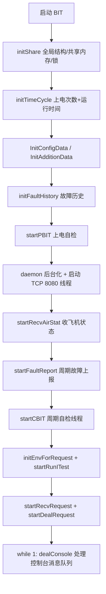

# BIT 维测工具代码分析

BIT（Built-In Test，内建自检）是这套机载 WAP（无线接入点）应用中的一个独立进程，负责**开机自检、周期自检、维护人员主动自检**，并把结果通过故障上报通道和 LED/离散量输出。下面对其整体架构、自检项清单和每项的具体实现做详细分析。

---

## 一、总体架构与源文件职责

目录 `applications/BIT/` 分为 `inc/`（头文件）、`src/`（主程序）、`cmds/`（控制台小工具）三部分。

| 文件 | 职责 |
|---|---|
| `src/bit.c` | 主函数 `main`，初始化全局共享结构、启动各线程、监听控制台消息队列 |
| `src/test.c` | **自检核心**：所有自检项函数、测试表 `g_tTests`、故障表 `g_tFaults`、PBIT/CBIT/IBIT 调度 |
| `src/common.c/.h` | 全局共享结构 `g_tShare`、禁止条件、CPLD 离散量读取、3G 连接状态 |
| `src/dealRequst.c` | 与 IMMS（综合监控系统）的 ITest 命令交互、故障历史读写、起动测试队列 |
| `src/faultReport.c` | 向 IMMS 周期上报成员状态/故障、控制 SYSTEM LED 与故障离散量 |
| `src/faultHistory.c` | 故障历史环形缓冲（256 条），落盘 `wap_fault_history.log` |
| `src/aircraftStatus.c` | 接收飞机状态消息（飞行阶段、全局中止标志、时间同步） |
| `src/deviceUseInfo.c` | 上电次数/累计运行时间统计（双备份文件） |
| `src/ispPAC.c` | 通过 I²C 读取 ispPAC-POWR1220AT8 电源监控芯片各路电压 |
| `src/arpLoopback.c` | 原始套接字 ARP 回环测试（PHY/交换芯片回环） |
| `src/signalquality.c` | WIFI / 4G 信号质量（RSSI）读取 |
| `src/util.c` | PHY 寄存器读写（MDIO）、GPIO 读写、位操作工具 |
| `src/ATcmd.c` | 通过 `/dev/ttyUSB2` 下发 AT 指令与 4G 模组通信 |
| `src/logger.c`、`src/shm.c`、`src/sock.c` | 日志、共享内存、UDP 套接字封装 |
| `cmds/*.c` | 控制台工具：`ITest`、`faultinfo`、`deviceinfo`、`setbitloglvl`（通过 `bitcmd` 软链接调用，走 System V 消息队列与控制进程通信） |

### 主流程（`bit.c: main`）

关键点是：**BIT 是常驻后台进程**，`dealConsole` 是主循环，从 System V 消息队列 `IPC_MSG_FILE` (`/tmp/bitmsgfile`) 收命令；其余功能都在独立线程中运行。

---

## 二、自检项清单

自检项定义在 `src/test.c` 的测试表 `g_tTests[]` 中，共 18 项（ID 1~18，ID 0 表示“全部”）：

| ID | 名称 | 处理函数 | 生效阶段 | 最大失败次数 | 关联故障 |
|----|------|----------|----------|--------------|----------|
| 1 | 4G bus | `test3GBus` | P/C/I | 2 | 4G |
| 2 | 4G module | `test3GMod` | P/C/I | 3 | 4G |
| 3 | SIM card | `test3GSim` | P/C/I | 3 | SIM Card |
| 4 | WiFi bus | `testWifiBus` | P/C/I | 2 | WiFi |
| 5 | WiFi module | `testWifiMod` | P/C/I | 2 | WiFi |
| 6 | phy online | `testPHYBus` | I | 2 | Ethernet |
| 7 | mgmt loopback | `testPHYLoopback` | I | 1 | Ethernet |
| 8 | switch chip | `testSwitchBus` | P/I | 2 | Ethernet |
| 9 | switch port link | `testSwitchPortLink` | C | 2 | Ethernet |
| 10 | wireless control | `testWirelessControl` | C | 2 | Control WiFi/4G |
| 11 | power control | `testPowerControl` | C | 2 | Control Power |
| 12 | CPU available | `testCpuAvailRate` | C | 4 | Resource |
| 13 | MEM available | `testMemAvailRate` | C | 4 | Resource |
| 14 | storage available | `testStoAvailRate` | P/C/I | 1 | Resource |
| 15 | file check | `testFileCheck` | P/I | 1 | Resource |
| 16 | mount | `testMount` | P/C/I | 1 | Resource |
| 17 | overheat or overcool | `testTemp` | P/C/I | 4 | Resource |
| 18 | watchdog | `testWatchdog` | I | 1 | Resource |

> 阶段含义（`inc/test.h` 的宏）：`PBIT_EN=1<<0` 上电自检、`CBIT_EN=1<<1` 连续（周期）自检、`IBIT_EN=1<<2` 起动（维护）自检。`PCIBIT_EN` 表示三个阶段都测试。

### 三类自检的调度差异

- **PBIT（上电自检，`startPBIT`）**：系统上电时在 `bit.c` 中同步执行一次。执行前先 `getBitPreSts()` 读取上次保留的自检结果（`/tmp/.BIT` 下按测试 ID 存文件），并把每项的 `iHaveFail` 拉到临界，做到**上电复位即判故障**（不等计数累加）。
- **CBIT（周期自检，`doCBIT` 线程）**：先 `sleep(CBIT_START_SEC=30)` 等应用层就绪，然后每 `CBIT_INTERVAL_SEC=15` 秒轮询一次所有 `CBIT_EN` 项。每轮结束若检测到上层下发的切换消息（`g_messageChanged`）就清零。
- **IBIT（起动自检，`doIBIT`）**：由控制台或 IMMS 的 ITest 命令触发。先做**禁止条件判断**（`doIBIT`），不满足就回 `MSG_ITEST_INHIBITES_RESP`；满足则先跑 `funPreDo` 预处理，再跑 `funDoTest`，最后 `setBITsts` 落盘并 `setFault` 更新故障。

所有测试执行都用全局互斥锁 `g_tShare.tBITLock` 串行化，避免 PBIT/CBIT/IBIT 并发访问硬件。

---

## 三、自检项的具体实现

### 1~3. 4G 相关（`test3GBus` / `test3GMod` / `test3GSim`）
- **前置门控**：三项都先判断 `API_getMode()==MODE_UE`（UE 模式）且 `getDiscrete(DISC_WIRELESS)==SWITCH_ON`（无线开关打开），否则跳过（返回 `RET_OK`，不判失败）。
- **4G bus**：`popen("lsusb | grep '1199:9071'")` 检查 USB 上是否枚举到 Sierra/美的的 4G 模组（vendor 0x1199 / product 0x9071），用 `sscanf` 解析出 `ID xxxx:xxxx` 比对。
- **4G module**：`API_atRun(USB_ACM,"AT\r","OK",...)` 下发 AT 指令，收到 `OK` 即通过；顺带用 `AT+COPS?` 读取运营商名存入 `g_tShare.ac3GOper`。
- **SIM card**：先 `AT+CMEE=1`，再 `AT+CPIN?`；返回 `+CPIN: READY` 判通过并写 `/etc/status/sim_bit=1`，`+CME ERROR: 10` 判失败并写 `0`。
- **重要**：每个测试中途会再次读 `getDiscrete(DISC_WIRELESS)`，防止测试过程中无线开关被切换导致误判。

### 4~5. WiFi 相关（`testWifiBus` / `testWifiMod`）
- **门控**：`API_getMode()==MODE_AP` 才测；且 AP 模式下若 `DISC_WIRELESS != SWITCH_ON` 或 `getSoftwareONOff()!=SOFRWARE_ON`，直接返回（避免软件刚下发关断时误报）。
- **消息变化绕过**：先检查 `getSoftwareONOff_changed_flag()`——该标志由 `bit.c` 中的 TCP 8080 服务器线程设置：外部下发一个整数消息，若与上一次不同则置 `g_messageChanged=1`。若测试过程中消息变化，则跳过自检直接返回，**防止切换无线射频电源时把瞬时状态误判成故障**。
- **4G/WiFi bus**：`lspci -n | grep '168c:003c' | wc -l`，即 PCIe 上（WIFI_PCIE_VENDOR 0x168c / PRODUCT 0x003c）查到 2 个设备判通过；`test3GBus` 则用 `lsusb`。
- **WiFi module**：对 `wlan0`、`wlan1` 执行 `iw dev wlanX info`，若出现 `No such device` 或输出为空则判失败（BUG CaYTH00000209 增加的 wlan1 检查）。

### 6. PHY online（`testPHYBus`）
- 通过 MDIO 读 PHY 寄存器：`getPhyID(skfd,"mgmt0",...)` → `mdioRead(MII_PHY_ID1)` 和 `MII_PHY_ID2`，把两次结果拼成 `(ID1<<6)+(ID2>>10)`，与 `MARVELL_OUI (0x005043)` 比较，判断 PHY 是否为 Marvell 芯片。底层 `getPhyID/mdioRead/mdioWrite` 在 `src/util.c` 中用 `ioctl(SIOCGMIIPHY/SIOCGMIIREG/SIOCSMIIREG)` 实现。

### 7. mgmt loopback（`testPHYLoopback`）
- `funPreDo` 是 `sendWait`：先给上层发 `MSG_ITEST_WAIT` 请求让操作员等待 `WAIT_TIME_LB=1` 分钟（回环会短暂断网）。
- 测试步骤：读并保存 `MII_BMCR`、`MII_SCR` → `brctl delif br0 mgmt0` 摘端口 → 写 `BMCR=reset|duplex`、再写 `BMCR=loopback|duplex`、写 `SCR` 强制 linkup → `arpLPtest("mgmt0")` 做 ARP 回环 → 无论成败都恢复寄存器并重新 `brctl addif`/加 VLAN。失败判 `TEST_FAIL_LATCH`（锁存故障，需复位才清除）。

### 8. switch chip（`testSwitchBus`）
- `popen("Lsconfig readPortReg 0 3")`，读交换芯片端口 0 的寄存器 3（标识寄存器），判断输出是否含 `data is 0x165`（芯片标识 0x165x）。

### 9. switch port link（`testSwitchPortLink`）
- `getNetlinkStatus` 用 `ifconfig lan0 | grep RUNNING`，有输出即 UP；lan0 或 lan1 任一 link up 即通过。

### 10. wireless control（`testWirelessControl`）
- 先 `getAllVolt()` 读 ispPAC 各路电压，`getDiscrete(DISC_WIRELESS)` 读无线开关离散量。
- 按模式判定电压与开关是否自洽：
  - **AP 模式**：WIFI0/WIFI1 电压 ≥ `VOLTAGE_WIFI_LOW_LEVEL(3000mV)` 时应为“关”，<3000mV 时应为“开”，否则失败。
  - **UE 模式**：对比 `ISP_CHN_3G` 电压与开关离散量。
  - **IDLE 模式**：三路都判。
- 同样有消息变化绕过逻辑。

### 11. power control（`testPowerControl`）
- 读 `getDiscrete(DISC_POWER)`，为 `SWITCH_OFF` 判失败，否则通过。

### 12~13. CPU/MEM 资源（`testCpuAvailRate` / `testMemAvailRate`）
- **CPU**：读 `stat` 第一行两次（间隔 1 秒），计算总时间差与 idle 差（`iowait` 计入 idle，PR#AWCU00000473），使用率 `fCpuUR<80%` 通过（`CPU_HIGH_USE=80.0`）。
- **MEM**：读 `meminfo` 的 `MemTotal`/`MemFree`，`(总-空)/总 < 80%` 通过（`MEM_HIGH_USE=80.0`）。

### 14. storage available（`testStoAvailRate`）
- `df -h | grep /dev/mtdblock5 | awk '{print $5}'` 取 NOR 分区使用率，`>90%`（`USE_RATE_HIGH_LEVEL`）判失败。

### 15. file check（`testFileCheck`）
- 主镜像 `/dev/mtd2`(WAPSYS)、`/dev/mtd4`(WAPAPP) 用 `vervalid` 校验镜像有效性（`testFileValid` 调外部 `vervalid <file> <type>` 判断输出 "valid"）。
- 主 APP 校验失败时回退校验 `/dev/mtd3`(出厂版本)；再用 `testFileIsWrt` 读镜像头 4 字节判断是否写入过（`0xFFFFFFFF` 视为未写入，允许）。配置分区 `/mnt/nor0/wapconfig_file` 单独校验。失败判 `TEST_FAIL_LATCH`。

### 16. mount（`testMount`）
- `df -h | grep /dev/mtdblock5 | wc -l`，行数 >0 表示已挂载。

### 17. 温度（`testTemp`）
- I²C 读 MAX6635（地址 0x48，总线 1）温度寄存器，`maxReg2Val` 转值 ×0.0625；与 `iHighTemp/iLowTemp`（默认 88℃/-43℃，可用环境变量覆盖）比较判超温/超低温。
- 同时读 TMP411（0x4c）远端温度存 CPU 温度，并维护实测最大/最小温度 `iRealHigh/iRealLow`、`iCpuMax/iCpuMin`。

### 18. watchdog（`testWatchdog`）
- 通过 CPLD 写 `CPLD_IOC_REG` 的 `WD_10S` 位使能看门狗 → `killall watchdogd` 停喂狗 → `sleep(7)` → 读 `CPLD_RST_REG` 判断是否因看门狗复位；再启动 `watchdogd 1000 &` 验证复位寄存器。失败判 `TEST_FAIL_LATCH`。

---

## 四、结果处理与故障上报机制

### 测试状态与故障状态
- 测试结果（`api_inc.h`）：`TEST_PASS=0`、`TEST_FAIL=1`、`TEST_FAIL_LATCH=3`。
- 故障状态（`api.h`）：`FAULT_INACTIVE=0`、`FAULT_ACTIVE=1`、`FAULT_LATCHED=3`。

### 失败去抖（`checkFailCon`）
每次测试失败时 `iHaveFail++`；只要 `iHaveFail < iMaxFail` 就把结果**回写成 PASS**（去抖，防止瞬时故障误报）；累计到 `iMaxFail` 才真正判故障。对应维护项会记录首次失败时间戳 `tTs`，恢复时清零。

### 故障聚合（`setFault`）
- 故障结构 `TFault` 用位图 `ullFaultCause` 记录“哪些测试 ID 触发了本故障”（`bit iTestID`），另有 `ullLatchedCause` 记录锁存类原因（BUG AWCU00000286 引入）。
- 测试通过则清除对应位；全部清除时打印并记录 `fault xxx have recovered`，状态置 `FAULT_INACTIVE`。
- 任一测试失败则置位并置 `FAULT_ACTIVE`/`FAULT_LATCHED`，同时调 `logFault` 写故障历史。

### 周期故障上报（`faultReport.c: faultReport`）
- 上报线程 `configAndFaultReport` 每秒跑一趟：每 `FAULT_REPORT_CYCLE=1s` 发一帧 `MSG_MEMBER_STATUS`（含 7 个故障各 2 bit 的状态、禁止条件、WiFi 关联数、状态字节）；每 `CONFIG_DATA_CYCLE=4s` 发配置数据和附加数据。
- 故障状态经 `updateFault` 做“保持 3 秒”（`FAULT_REPORT_KEEP_TIME`）后才切换，避免抖动。
- 同时驱动 SYSTEM LED（`setFaultToLed`：有故障黄灯、无故障绿灯）和故障离散量输出 `setFaultToDisc`（写 CPLD `CPLD_FAULT_OUT_BIT`）。
- 上行 `MSG_MEMBER_STATUS` 里带 `getConds()` 的禁止条件。

### 故障历史（`faultHistory.c`）
- `TFaultHiss` 是 256 条（`MAX_SAVE_HISTORY_NUM`）环形缓冲，`logFault` 从 `iHisHead` 向前写，`initFaultHistory` 启动时从 `/mnt/nor0/wap_fault_history.log` 加载。控制台 `faultinfo` 命令可读回。

---

## 五、禁止条件（Inhibit Conditions）

定义在 `inc/common.h`（`INH_COND_MASK=0x7C`），是执行 IBIT 前的门控，`bit.c`/`aircraftStatus.c` 里通过 `setCond` 设置：

| 位 | 含义 | 来源 |
|----|------|------|
| `TEST_COMPLETE_BIT`(0) | 测试完成标志 | `runITest` 置位 |
| `ABLE_TO_TEST_BIT`(1) | 允许测试（全局中止的反相） | 飞机状态 `ucGaf` |
| `INH_DLA_UPLOADING`(2) | 数据加载器正在上传 | `faultReport` 每周期更新 |
| `INH_NOT_MAINTENANCE`(3) | 非维护阶段 | 飞行阶段 `ucFP != FP_MAINTENANCE` |
| `INH_GLOBAL_ABORT`(4) | 全局中止（BUG AWCU00000168） | `ucGaf` |
| `WIRELESS_LINK_BIT`(7) | 无线链路通 | `faultReport` 更新 |

`doIBIT` / `dealITestRunCmd` 都会先 `getConds() & INH_COND_MASK`，若命中该测试的 `ucInhConds` 就回 `MSG_ITEST_INHIBITES_RESP` 拒绝执行。

---

## 六、与外部系统的接口

### 1. 向 IMMS 的 UDP 通道（`comType.h`）
- `PORT_AS_L=50102` 收飞机状态；`PORT_IT_L=50103` 收 ITest 命令/应答；`PORT_CF_L=50100` 发配置与故障上报。
- ITest 交互消息：`MSG_ITEST_RUN_CMD/INTEST_RESP/INHIBITES_RESP/ABORT_CMD/CONTINUE_CMD/WAIT`，以及节拍/故障历史获取等。命令校验 `checkMsg`、应答用 `sendAndWaitAck`（超时 3 秒、重发 3 次，配套 ACK/NAK/FAIL）。

### 2. 与 DLA 的共享内存（`TBitDlaShm`）
- 字段：`iDLAHB`（数据加载器心跳）、`iUploading`、`iIBIT`、`iInMaintenance`、`iDlResult`。`testDlaHB`/`testDlaRes` 通过心跳变化判断数据加载器是否健康。

### 3. 控制台工具（`cmds/`）
通过 System V 消息队列（`ftok("/tmp/bitmsgfile")`）与主进程通信，消息类型 `MTYPE_*`：
- `ITest -l` 列出全部测试，`ITest -t <ID>` 执行指定测试（ID 0 为全部）——对应 `dealConsole` 的 `MTYPE_DOTEST_CMD`。
- `faultinfo` 打印各故障状态与原因（`faultCause` 把位图转成测试 ID 列表）。
- `deviceinfo` 打印温度、信号质量、上下电次数、运行时间、各路电压。
- `setbitloglvl <0~7>` 设置日志等级。

其中 `bit.c` 还额外起了一个**监听 8080 端口的简易 TCP 服务器**，接收外部下发的整数“软件开关”消息，用于在无线射频切换时令自检绕过（配合 `getSoftwareONOff_changed_flag`）。

---

## 七、几个值得注意的设计点

1. **无线开关联动**：多处测试在测前、测中二次读取 `DISC_WIRELESS`/`SOFRWARE_ON`，并配合 `getSoftwareONOff_changed_flag` 绕过，避免射频电源切换造成误报——这是这套代码里最明显的现场问题修补痕迹。
2. **PBIT 首判 + 去抖**：上电自检把 `iHaveFail` 预置为 `iMaxFail-1`，使 `checkFailCon` 一次失败即成立；而 CBIT 走完整计数去抖。
3. **锁存语义**：PHY/交换回环、文件校验、看门狗这类“硬故障”用 `TEST_FAIL_LATCH`（故障锁存，需复位），其余用 `TEST_FAIL`（可自动恢复）。
4. **大量 `#ifdef NEVER` / BUG 注释**：代码保留了历史修改痕迹（如 AWCU0000xxxx、CaYTH00000xxx），是现场问题驱动演进的结果，阅读时需注意这些已注释逻辑不影响当前行为。

如果你希望，我可以针对某个具体自检项（例如 `testPHYLoopback` 的 MDIO 回环流程或 `testWatchdog` 的 CPLD 时序）画出更细的时序图，或分析某条故障上报代码路径。